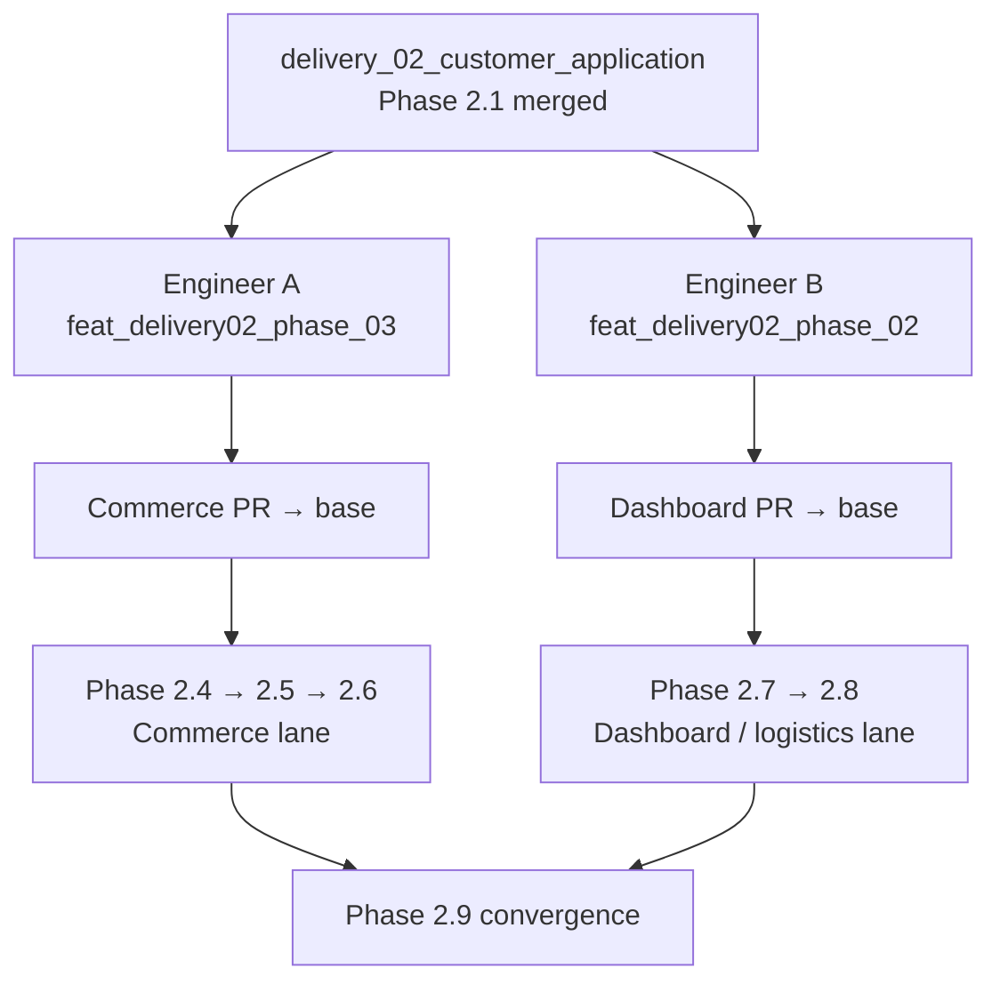

# CarChief Branching Strategy

For Delivery 01, `delivery_01_public_website` is the stable integration branch. Each phase has a phase branch created from the latest approved integration branch. Tasks for that phase run directly on the phase branch; task-specific branches are not required.

## Branch flow

```mermaid
gitGraph
   commit id: "approved baseline"
   branch feat_delivery01_phase_03
   checkout feat_delivery01_phase_03
   commit id: "Phase 03 implementation and tests"
   checkout delivery_01_public_website
   merge feat_delivery01_phase_03 tag: "Phase 03 PR merged"
   branch feat_delivery01_phase_04
   checkout feat_delivery01_phase_04
   commit id: "Phase 04 implementation and tests"
   checkout delivery_01_public_website
   merge feat_delivery01_phase_04 tag: "Phase 04 PR merged"
```

The integration branch remains the reviewed baseline. A later phase starts only after the previous phase has passed its review gate and has been merged.

## Visual phase handoff

```mermaid
flowchart LR
    A[delivery_01_public_website<br/>Approved baseline] --> B[Create<br/>feat_delivery01_phase_03]
    B --> C[Implement and test<br/>Phase 03 tasks]
    C --> D[PR and AI/tech-lead review]
    D --> E[Merge into<br/>delivery_01_public_website]
    E --> F[Create<br/>feat_delivery01_phase_04]
    F --> G[Implement and test<br/>Phase 04 tasks]
    G --> H[PR and AI/tech-lead review]
    H --> I[Merge into<br/>delivery_01_public_website]
```



This shows the important handoff: every phase returns to the stable integration branch after review. The next phase is created from that updated branch, so unreviewed work is not carried forward accidentally.

## Standard phase workflow

1. Switch to the integration branch and pull the latest approved changes.
2. Confirm the working tree is clean.
3. Create the phase branch from the updated integration branch.
4. Execute all phase tasks on that phase branch.
5. Run tests, AI self-review, UI evidence and phase acceptance checks.
6. Commit the reviewed phase changes manually.
7. Open a PR from the phase branch to the integration branch.
8. Complete AI-assisted review and tech-lead review.
9. Merge the PR manually after approval.
10. Create the next phase branch from the newly updated integration branch.

## Example: Phase 03

```bash
git switch delivery_01_public_website
git pull --ff-only origin delivery_01_public_website
git status --porcelain=v1 --untracked-files=all
git switch -c feat_delivery01_phase_03
```

All Phase 03 tasks run on `feat_delivery01_phase_03`. Its PR is:

```text
feat_delivery01_phase_03  →  delivery_01_public_website
```

## Example: Phase 04

Phase 04 must start from the updated integration branch, not directly from the Phase 03 branch:

```bash
git switch delivery_01_public_website
git pull --ff-only origin delivery_01_public_website
git status --porcelain=v1 --untracked-files=all
git switch -c feat_delivery01_phase_04
```

Its PR is:

```text
feat_delivery01_phase_04  →  delivery_01_public_website
```

This gives Phase 04 the approved Phase 03 baseline plus only Phase 04 changes.

## Rules

- Never start a phase from an unreviewed phase branch.
- Never merge one phase directly into another phase branch.
- Do not begin the next phase while the previous phase PR is under review.
- Do not bypass task dependencies or the execution frontier.
- Task agents must not commit, push, merge or self-approve unless explicitly authorized.
- A dirty working tree blocks branch creation; resolve it manually first.
- Exact branch names are defined by the phase task files and task controller.

Delivery 02 uses the same pattern with `delivery_02_customer_application` as the integration branch and `feat_delivery02_phase_NN` as phase branches.

## Delivery 02: protected two-engineer lanes

Phase 2.1 is the one shared foundation PR. Once it has merged, two engineers may work from the same current `delivery_02_customer_application` baseline. Each phase gets its own branch and its own PR back to that base; no phase branch is based on another unmerged phase branch.



The lanes have exclusive path ownership, registered by `D02-P01-T004`:

- Commerce: customer inventory, My Vehicles, invoices and payments.
- Dashboard / logistics: dashboard, shipments/documents, notifications and profile.

Neither lane changes shared route registries, generated-client aggregation, Mock API bootstrap, package manifests, lockfiles, Docker files, shared theme packages, shared vehicle packages, or the other lane’s paths. A shared-platform need is handled as a small serialized PR first. Each engineer rebases their branch onto the latest delivery base immediately before updating their PR.
