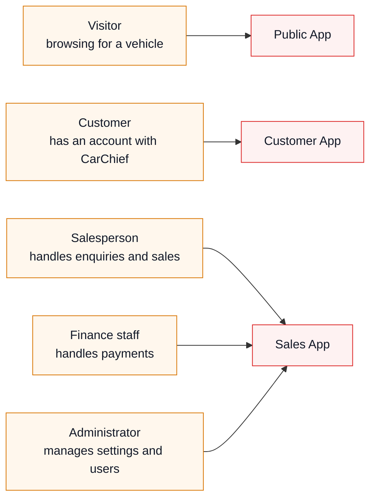
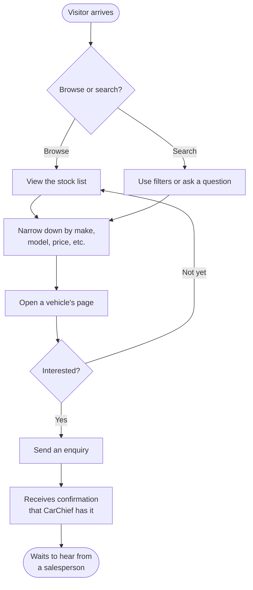
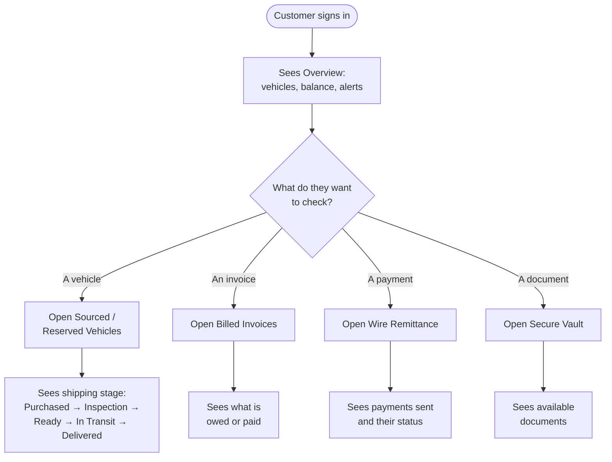
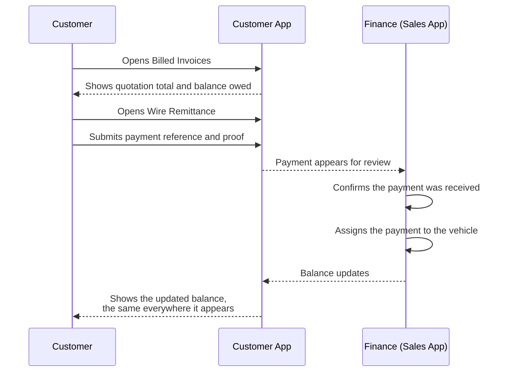
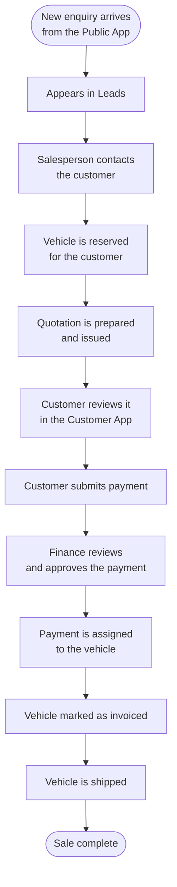
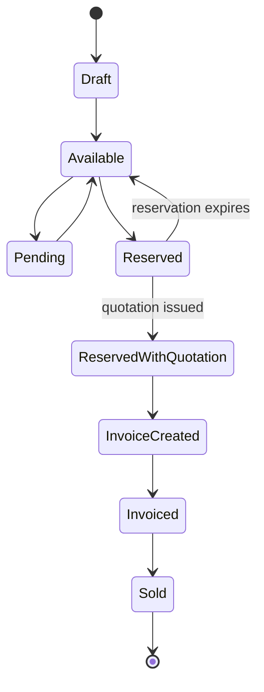
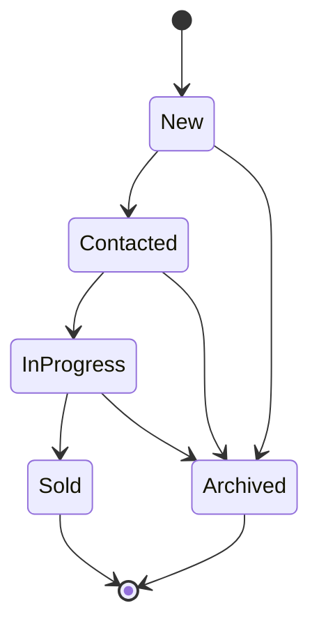
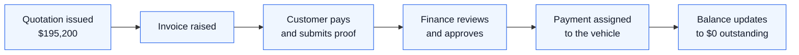

# CarChief — Requirements

## What this document is

This document describes, in plain language, what the CarChief system must do. It is written for anyone involved in the project, not just technical people. There are no technical terms in this document — where a business term is unavoidable (like "bill of lading"), it is explained in the Glossary at the end.

Every requirement has a short reference code, like `PUB-04` or `SALES-22`, so it can be pointed at in a meeting, an email, or an approval.

Where something could not be confirmed or needs a decision, it is marked like this:

> ⚠ **NEEDS A DECISION** — a short note on what is unclear, with a reference number pointing to the Open Questions section at the end.

Nothing marked this way should be treated as agreed. Everything else in this document is intended to be built as written.

**How this document was produced.** CarChief already has a working demonstration system. It was tested by hand — every screen, button and form was tried — to understand what the finished product should do. Where the demonstration does something correctly, this document asks for that behaviour. Where the demonstration does something wrong (and a few things were found to be wrong), this document asks for the **correct** behaviour instead, not a copy of the mistake.

---

## What CarChief does

CarChief buys premium and used vehicles — mainly from Japan — and sells them to buyers around the world. It arranges the ocean shipping, the paperwork needed to clear customs, and delivery to the buyer's port or city.

Three groups of people use the system:

1. **Visitors** — anyone browsing the public website, looking for a vehicle
2. **Customers** — people who have bought, or are buying, a vehicle from CarChief
3. **CarChief staff** — the sales, finance and administration team

This means three separate applications, each built for one group.

---

## Who uses the system

A finance person and an administrator use the same application as a salesperson — the Sales App — but see only the parts of it their role permits.

## BA operational workflow baseline

The following workflow was supplied by the business analyst in [`docs/CarChief-BA-Workflow-Coverage-Matrix.md`](docs/CarChief-BA-Workflow-Coverage-Matrix.md), based on the draw.io export `/Users/prabodha/Downloads/car_chief_user_journey.json`. It extends the application requirements below; it does not replace them.

> **Colour evidence limitation:** the JSON export contains labels and edges but no encoded fill/stroke colours. Blue/clear/green ownership is therefore provisional from the BA legend and must be confirmed by the process owner before implementation.

### Upstream stock and publication

**WF-01 — BA-confirmed workflow:** Procurement, bidding, VBMS entry, Oracle NetSuite updates, ERP CSV extraction, auction activity and auction-image collection occur before or alongside CarChief stock preparation. These are external or manual boundaries unless separately approved for integration.

**WF-02 — Recommendation:** CarChief shall validate imported vehicle and shipment data before commit, report duplicates and partial failures, and retain source/reference metadata. It shall not silently become the authoritative procurement or ERP record.

**WF-03 — Open question:** Operational lifecycle, price readiness, commercial sale state, public visibility, customer visibility and country availability shall be represented as distinct concepts until management approves the canonical field vocabulary.

**WF-04 — BA-confirmed workflow:** A vehicle may be available to selected countries before its price is ready, subject to the approved visibility policy. A customer may request a price when the price is unavailable; the resulting request type and routing require confirmation.

### Enquiry, negotiation and PI

**WF-05 — BA-confirmed workflow:** An enquiry may enter through Customer Support, be screened, and be assigned to the relevant country salesperson before negotiation starts. WhatsApp is a lead-source/integration boundary until an actual provider is approved.

**WF-06 — BA-confirmed workflow:** A salesperson can start negotiation and the record becomes “Under Negotiation”. The negotiation timer and expiry outcome require business approval.

**WF-07 — Open question:** Confirm whether the negotiation timer is the same as, or separate from, the existing 48-hour reservation hold. The implementation shall model them separately until confirmed.

**WF-08 — BA-confirmed workflow:** After customer confirmation, a salesperson can create a proforma invoice and the record can become “Under Negotiation With PI”. A 72-hour payment timer and its expiry/cancellation behavior require approval.

### Payment, Ship OK and documents

**WF-09 — BA-confirmed workflow:** A TT/payment record can be created with proof, reviewed by Finance against a bank statement, held with a reason, re-submitted, approved or rejected, and allocated to the relevant invoice/vehicle. Allocation must be idempotent and cannot double-spend funds.

**WF-10 — BA-confirmed workflow:** A second or due payment may follow the Ship OK stage. Its relationship to invoice status, remaining balance and shipment release requires approval.

**WF-11 — BA-confirmed workflow:** Ship OK is a separate request and approval process. CarChief UI approvals and ERP/IBQ checkpoints must be represented separately; no frontend action may claim an ERP approval occurred without an integration or recorded manual checkpoint.

**WF-12 — BA-confirmed workflow:** Document release is a separate request and approval process. Documents become customer-visible only after the approved release and upload rules are satisfied.

**WF-13 — Recommendation:** The BFF/mock service, not the browser, shall enforce workflow transitions, timers, role checks, idempotency, allocation rules and approval-gated document visibility.

**WF-14 — Open question:** Confirm the approvers, rejection/return paths, notification channels, document categories, retention and scanning rules for Ship OK and document release.

## Progressive Web App requirements

The frontend shall be installable as a Progressive Web App on supported browsers. PWA support means an installable app shell and safe offline behavior; it does not make financial or approval workflows safe to execute without the server.

**PWA-01 — Recommendation approved for planning:** Public, Customer and Salesperson applications shall each provide an application manifest, icons, responsive standalone presentation and an install/update experience appropriate to that application.

**PWA-02 — Recommendation approved for planning:** Each application shall provide an offline shell/fallback page and clearly indicate online/offline state. Public content may use explicitly approved read-only cache data; authenticated data must be scoped to the signed-in user.

**PWA-03 — Security rule:** Payment proofs, invoices, customer documents, identity data, staff data and other sensitive records must not be broadly cached by a service worker. Offline mutations, payment submission, approvals, allocation, Ship OK and document release are not permitted; the user must be prompted to reconnect.

**PWA-04 — Recommendation approved for planning:** Service-worker versioning, update notification, cache expiry, logout cache cleanup and recovery from stale/broken caches shall be tested. Production must never cache mock data or credentials.

**PWA-05 — Open question:** Confirm whether push notifications, background sync, camera/file capture and install analytics are required. They are excluded from the initial PWA baseline until approved.

---

## The complete journey

This is how one sale moves through all three applications, from a visitor's first look to a delivered vehicle.

```mermaid
flowchart LR
    A["1. Visitor finds a vehicle<br/>on the Public App"] --> B["2. Visitor sends an enquiry"]
    B --> C["3. Salesperson receives the enquiry<br/>and reserves the vehicle"]
    C --> D["4. Salesperson prepares a quotation"]
    D --> E["5. Customer reviews the quotation<br/>in the Customer App"]
    E --> F["6. Customer pays and<br/>submits proof of payment"]
    F --> G["7. Finance confirms the payment<br/>and assigns it to the vehicle"]
    G --> H["8. CarChief ships the vehicle"]
    H --> I["9. Customer tracks delivery<br/>and receives documents"]

    classDef pub fill:#fff7ed,stroke:#d97706,color:#111827
    classDef sales fill:#fef2f2,stroke:#dc2626,color:#111827
    classDef cust fill:#ecfdf5,stroke:#059669,color:#111827
    class A,B pub
    class C,D,G,H sales
    class E,F,I cust
```

This journey is what every part of this document supports. Each of the nine steps is covered by requirements in Parts 1–3 below.

---

# Part 1 — Public App

## Purpose

The Public App is CarChief's shop window. Anyone can look, search and ask questions — no account is required. Its job is to help a visitor find the right vehicle and make it easy to get in touch.

## Features

- A home page introducing CarChief and showing a selection of vehicles
- Two ways to search: choosing filters, or typing a plain question
- A full stock list with filtering and sorting
- A page for each vehicle with photos and full details
- A shipping cost estimate
- An enquiry form to ask about a vehicle or request a quote
- Public stock categories and country-aware availability where approved
- Public auction guidance and account-gated live-auction entry where approved
- Company information: About Us, How to Buy, Services, Testimonials, Frequently Asked Questions, Contact details, policy and other approved public content

## Visitor journey

## Requirements

**PUB-01** A visitor can view the home page without creating an account or signing in.

**PUB-02** The home page shows a selection of available vehicles.

**PUB-03** A visitor can search for vehicles by typing a plain question, such as "SUVs under $50,000."

**PUB-04** A visitor can search using a set of filters: make, model, body type, year, price range, and fuel type.

**PUB-05** The choices offered in each filter (for example, which makes appear) always reflect the vehicles actually in stock — never a fixed list that could show a make with nothing available.

**PUB-06** A visitor can sort results by newest, price low to high, or price high to low.

**PUB-07** If a search or filter finds nothing, the visitor sees a clear message saying so — never a blank screen or made-up results.

**PUB-08** A visitor can manually refresh the stock list to see the latest availability.

**PUB-09** Each vehicle has its own page showing photos, specifications, and price.

**PUB-10** A vehicle's page can be shared as a single link that opens directly to that vehicle, from a fresh browser with nothing pre-loaded.

**PUB-11** Each vehicle's page carries its own title and description, so it can be found and shared properly through search engines and social media.

**PUB-12** A visitor can estimate the shipping cost to their destination before enquiring.

> ⚠ **NEEDS A DECISION** — see Open Question 3. How shipping cost should actually be calculated was not something we could confirm.

**PUB-13** A visitor can submit an enquiry about a specific vehicle, or a general enquiry, giving their name, email, phone number and a message.

**PUB-14** Before an enquiry is accepted, the system checks that the name, email and phone number are filled in correctly and sensibly — not just left for the visitor's own browser to catch.

**PUB-15** After sending an enquiry, the visitor sees a clear confirmation that it was received.

**PUB-16** An enquiry submitted here must reach the Sales App and appear in a salesperson's list of new leads. *(See RULE-08 — this must never fail silently.)*

**PUB-17** A visitor can read an "About Us" page describing the company.

**PUB-18** A visitor can read a "How to Buy" page explaining the buying process step by step.

**PUB-19** A visitor can read customer testimonials, and can submit their own.

**PUB-20** A visitor can browse a Frequently Asked Questions page, organised into twelve categories.

**PUB-21** A visitor can find CarChief's contact details, including office locations and operating hours.

**PUB-22** A visitor can begin the process of creating a customer account or signing in, from the Public App.

**PUB-23** If a visitor tries to reserve a vehicle without an account, they are told clearly what they need to do next, rather than the action silently failing.

**PUB-24** An address from CarChief's old website that a visitor or a search engine might still use leads to the correct new page, rather than a broken page.

> ⚠ **NEEDS A DECISION** — see Open Question 18. Which old addresses need to keep working was not something we could confirm.

**PUB-25 — Source-confirmed by legacy public-site audit:** A visitor can browse only the approved public stock categories (for example, arrival, premium or clearance) and country-specific stock projections. Category, country eligibility, operational status, commercial state, publication and price readiness remain distinct server-authoritative concepts.

**PUB-26 — Source-confirmed controls; semantics open:** A visitor can see approved country, currency and language choices on public pages. The business must define which choice changes stock eligibility, price/currency display, content or language before implementation; the interface must not imply a conversion or localization it cannot perform.

**PUB-27 — Source-confirmed legacy route family:** A visitor can read approved auction services, calendar, terms, FAQ and buying guidance. Any Live Auction capability is account-gated or an approved external destination; auction-site access, bidding and data integration are not implied.

**PUB-28 — Source-confirmed contact pattern:** A visitor can use approved public contact actions, including vehicle/general enquiry and clearly labelled WhatsApp, email or call intent. The site must not claim a message, call, notification or external hand-off completed unless an approved service confirms it.

**PUB-29 — Source-confirmed legacy page; content source open:** A visitor can read an approved shipping-schedule page or a clear unavailable/recovery state. The application must never expose server errors, internal paths or fabricated schedule data.

**PUB-30 — Source-confirmed public content portfolio:** A visitor can read approved public company, services, team, gallery, news, security and bank-information content where management authorizes publication. Each item requires a content owner, approval state and safe public projection; sensitive bank, security or personal details are not published by default.

**PUB-31 — Source-confirmed legacy behaviour; legal content open:** A visitor can access approved privacy/cookie information and make a consent choice where legally required. The new frontend uses an approved consent mechanism and copy; it does not reuse legacy scripts or treat prior acceptance as consent.

---

# Part 2 — Customer App

## Purpose

The Customer App is a private area where an existing CarChief customer can see everything about their own vehicles, money and paperwork — without needing to ask a salesperson for an update.

## The nine areas

| Area | What it is for |
|---|---|
| Overview | A summary of the customer's account: vehicles, balance, recent activity |
| Browse Stock | The same vehicle browsing as the Public App, available inside the account |
| Sourced Vehicles | Vehicles the customer has reserved but not yet fully paid for |
| Reserved Vehicles | The same information, viewed by reservation status |
| Billed Invoices | Every invoice issued to the customer |
| Wire Remittance | A record of payments the customer has sent |
| Secure Vault | Documents belonging to the customer |
| Bulletins | Notifications and announcements from CarChief |
| Profile | The customer's own contact details and account settings |

## Customer journey — checking on an order

## Customer journey — paying for a vehicle

## Requirements

**CUST-01** A customer signs in to reach any part of this application. No screen is reachable without doing so.

**CUST-02** A customer can only ever see their own vehicles, invoices, payments and documents — never another customer's.

**CUST-03** A customer who forgets their password can recover access without contacting CarChief directly.

> ⚠ **NEEDS A DECISION** — see Open Question 8. Password recovery was not present in the demonstration.

**CUST-04** The Overview page shows, at a glance: how many vehicles the customer has, their account balance, and any recent alerts.

**CUST-05** The Overview page shows the customer's account tier and any discount it carries. *(See RULE-06.)*

**CUST-06** The Overview page shows the customer's credit limit and how much of it is currently being used.

*Example — credit utilisation:* if a customer has a credit limit of $500,000 and currently owes $120,000, the utilisation shown is **24%** ($120,000 ÷ $500,000).

**CUST-07** A customer can switch the display between a light and a dark appearance.

**CUST-08** A customer can manually refresh their account information to see the latest data.

**CUST-09** A customer can browse and search the same vehicle stock as the Public App, without leaving their account area.

**CUST-10** Vehicles the customer is buying are grouped clearly: reserved, reserved with a quotation issued, and fully invoiced — each group showing how many vehicles it contains.

**CUST-11** Each vehicle shown to the customer displays its current shipping stage: Purchased, Inspection, Ready, In Transit, or Delivered. *(See RULE-04.)*

**CUST-12** A vehicle that has been reserved but not yet invoiced shows the deposit amount owed. *(See RULE-07 for how the deposit is calculated.)*

**CUST-13** Every vehicle shown to the customer is a real, single vehicle — never counted twice because it appears in more than one list.

**CUST-14** A customer can view every invoice issued to them, with its total amount, what has been paid, and what remains outstanding.

**CUST-15** A customer can view and print or download any of their invoices.

**CUST-16** The outstanding balance shown for an invoice is calculated the same way, and shows the same figure, everywhere it appears in the application. *(See RULE-01 — this is one of the most important rules in this document.)*

**CUST-17** A customer can view a log of every payment they have sent, including its reference number, date, amount, and current status (pending, approved, or rejected).

**CUST-18** A customer can submit a new payment record, including a reference number and proof of payment.

**CUST-19** A payment that has already been fully assigned to a vehicle is never shown as still available to assign again.

**CUST-20** A customer can access a secure area holding their documents, organised into categories: Proforma Invoice, Commercial Invoice, Bill of Lading, Inspection Certificate, Export Certificate, Insurance, Packing List, Vehicle Photos, Auction Sheet, and Other.

**CUST-21** A document generated for a customer (such as an invoice) automatically appears in their document area — it is never generated but left unavailable to them.

> ⚠ **NEEDS A DECISION** — see Open Question 9. How a customer uploads their own documents (such as identification) was not something we could confirm.

**CUST-22** A customer can view notifications and announcements from CarChief, mark them as read, and see which are new.

**CUST-23** A customer can view and update their own contact details: company name, phone number, and delivery address.

**CUST-24** A customer's name and email address are shown but cannot be changed directly by the customer.

**CUST-25** A customer can change their account password.

---

# Part 3 — Sales App

## Purpose

The Sales App is CarChief's internal system, used every day by the sales, finance and administration teams. It covers the whole operation: turning an enquiry into a sale, tracking payments, and managing the information everything else depends on.

It has five main areas: **Dashboard, Inventory, Leads, Finance,** and **Master Controls** (administration).

## Sales journey — enquiry to completed sale

## Dashboard

**SALES-01** A salesperson signs in before reaching any part of this application.

**SALES-02** After signing in, a salesperson sees a Dashboard summarising the current state of the business: key figures, a monthly target, and a five-stage sales pipeline.

**SALES-03** The Dashboard shows twelve key performance figures covering vehicles, leads, quotations and payments.

**SALES-04** The Dashboard shows progress toward a monthly sales target.

**SALES-05** The Dashboard shows the sales pipeline across five stages: New Leads, Contacted, Quotation Issued, Payment Pending, Completed. *(See RULE-03.)*

**SALES-06** The Dashboard offers six one-click actions: add customer, create lead, create quote, reserve vehicle, record bulk payment, and view approved payment logs.

**SALES-07** The Dashboard highlights leads that need urgent follow-up.

**SALES-08** Every figure and chart on the Dashboard is calculated from real, current data. If there is no data yet, the Dashboard shows that clearly — it never invents a figure to avoid showing zero. *(See RULE-09 — this was found to be broken in the demonstration and must not be repeated.)*

**SALES-09** A salesperson can search across customers, vehicles and invoices from one place.

> ⚠ **NEEDS A DECISION** — see Open Question 14. How broad or fast this search needs to be was not something we could confirm.

## Inventory

**SALES-10** A salesperson can view the full stock list, with search, filtering and sorting.

**SALES-11** A salesperson can add a new vehicle to stock, giving its make, model, year, condition, price and specifications.

**SALES-12** A salesperson can edit an existing vehicle's details.

**SALES-13** A salesperson can view a full specification sheet for a vehicle, covering thirty-seven separate details.

**SALES-14** When adding a vehicle, a salesperson can start from a ready-made template for common vehicle types (sports car, luxury SUV, luxury sedan) to save time.

**SALES-15** A salesperson can manage a vehicle's photos, including which are shown publicly.

> ⚠ **NEEDS A DECISION** — see Open Question 10. Photo management could not be fully tested.

**SALES-16** A salesperson can remove a vehicle from stock, after confirming the action.

**SALES-17** When a vehicle is edited or removed, that change is immediately visible everywhere the vehicle appears — never applied in one place while an older version still shows elsewhere. *(See RULE-08.)*

**SALES-18** A salesperson can reserve a vehicle for a customer for a limited time. *(See RULE-05 for the reservation period.)*

**SALES-19** Once a vehicle is reserved, the option to prepare a quotation for it becomes available immediately — never blocked by the system failing to notice the reservation. *(This was a specific failure found in the demonstration — reserving a vehicle did not reliably unlock the next step.)*

**SALES-20** A salesperson can bring in a batch of vehicles or shipment details from a spreadsheet.

> ⚠ **NEEDS A DECISION** — see Open Questions 5 and 6. What happens with a spreadsheet upload could not be confirmed, including what should happen if a vehicle's price is left blank.

## Leads

**SALES-21** Every enquiry from the Public App appears as a new lead, without exception. *(See RULE-08.)*

**SALES-22** A lead can be assigned to a salesperson.

**SALES-23** A salesperson can move a lead through its stages: New, Contacted, In Progress, Sold, or Archived. *(See RULE-02.)*

**SALES-24** A salesperson can keep private notes on a lead, visible only to staff.

**SALES-25** A salesperson can create a new customer record, or search for and select an existing one.

**SALES-26** A salesperson can view and edit a customer's details, including their tier.

## Quotations and invoicing

**SALES-27** A salesperson can prepare a quotation for a reserved vehicle.

**SALES-28** A quotation includes: the vehicle's price, freight cost, customs clearance, export inspection, port handling, insurance, and a percentage-based tax.

> ⚠ **NEEDS A DECISION** — see Open Question 2. Whether import duty should be its own separate line, distinct from the general tax figure, was not something we could confirm.

*Example — building a quotation:* vehicle price $189,900, plus freight $2,500, customs clearance $1,200, export inspection $450, port handling $350, and insurance $800. The total is:

$189,900 + $2,500 + $1,200 + $450 + $350 + $800 = **$195,200**

**SALES-29** If the customer has a discount tier, the discount is applied to the quotation automatically once the customer is selected. *(See RULE-06.)*

*Example — tier discount:* the same $189,900 vehicle, sold to a Platinum-tier customer with a 15% discount:

$189,900 − ($189,900 × 15%) = $189,900 − $28,485 = **$161,415**

**SALES-30** A quotation can be prepared in any of seven currencies: US Dollar, Japanese Yen, Euro, Ugandan Shilling, British Pound, Australian Dollar, or Canadian Dollar.

*Example — currency conversion:* at a rate of 1 USD = 163.93 JPY, a $1,000 line item becomes ¥163,930.

> ⚠ **NEEDS A DECISION** — see Open Question 1. We could not confirm how rounding and timing work when a payment is made in a different currency than it was billed in.

**SALES-31** A quotation states its trade terms — one of: CNF, FOB, CIF, or C&F. *(See Glossary.)*

**SALES-32** A quotation lists a shipping destination, chosen from at least twelve supported countries.

**SALES-33** A salesperson is shown on the quotation as the person responsible for the sale.

**SALES-34** A quotation can be previewed exactly as it will look when printed, before it is finalised.

**SALES-35** A salesperson can choose which details appear on the printed quotation.

**SALES-36** A finalised quotation can be emailed to the customer, or printed.

> ⚠ **NEEDS A DECISION** — see Open Question 13. Whether these connect to a real email or printing service was not something we could confirm.

**SALES-37** A quotation is issued with one single reference number, and that same number is shown everywhere the quotation is referenced. *(This was a specific failure in the demonstration — a quotation appeared under four different reference numbers in different places.)*

**SALES-38** A quotation can be converted into a final invoice once the sale is confirmed.

> ⚠ **NEEDS A DECISION** — see Open Question 7. What changes when a quotation becomes an invoice was not something we could confirm.

**SALES-39** A completed sale appears in a register of invoiced and sold vehicles, viewable by staff.

## Payments and finance

**SALES-40** Finance staff can view all customer payments awaiting review.

**SALES-41** Finance staff can approve or reject a submitted payment, with a reason.

**SALES-42** Finance staff can view proof of payment submitted by a customer.

**SALES-43** An approved payment can be assigned to a specific vehicle.

**SALES-44** A payment that has already been fully assigned can never be assigned again to another vehicle.

*Example — why this matters:* a customer sends $195,200 for one vehicle. If that payment is accidentally assigned a second time to a different vehicle, CarChief would believe it has been paid twice for the same money. This must not be possible.

**SALES-45** Finance staff can enter multiple payments at once, for efficiency.

> ⚠ **NEEDS A DECISION** — see Open Question 16. Bulk payment entry could not be fully tested.

**SALES-46** Finance staff can view and maintain the exchange rates used for currency conversion, along with a history of past rates.

**SALES-47** A notification is shown when a payment is approved and ready to be assigned.

**SALES-48** A salesperson can earn commission on a completed sale, calculated as a fixed percentage.

> ⚠ **NEEDS A DECISION** — see Open Question 11. Whether commission or credit should ever be split between more than one salesperson on the same sale was not something we could confirm.

*Example — commission:* on a $189,900 sale at a 2.5% commission rate: $189,900 × 2.5% = **$4,747.50**

## Master Controls (administration)

**SALES-49** An administrator can maintain the list of countries and ports CarChief ships to.

**SALES-50** Every port is correctly linked to the right country, so a document never shows a port and country that do not match.

**SALES-51** An administrator can maintain shipping cost rates by destination and vehicle size.

> ⚠ **NEEDS A DECISION** — see Open Question 3.

**SALES-52** An administrator can maintain inland delivery cost rates by destination city.

> ⚠ **NEEDS A DECISION** — see Open Question 4.

**SALES-53** An administrator can set up a working starting set of shipping and delivery rates, rather than starting from nothing with no way to populate it.

**SALES-54** An administrator can maintain the list of banks used for receiving payment.

**SALES-55** An administrator can maintain standard terms and conditions text used on quotations.

**SALES-56** An administrator can maintain customer tiers and their discount percentages. *(See RULE-06.)*

**SALES-57** An administrator can maintain the company logo and branding shown across the applications.

**SALES-58** An administrator can maintain the Frequently Asked Questions shown on the Public App, across its twelve categories.

**SALES-59** An administrator can create staff accounts and assign them a role.

**SALES-60** An administrator can create custom roles and choose exactly which of the system's permissions each role has.

**SALES-61** Every action a staff member can take is governed by their role's permissions — a person without permission for an action cannot perform it, regardless of which screen they are on.

**SALES-62** An administrator can view a log of important system activity.

> ⚠ **NEEDS A DECISION** — see Open Question 15. In the demonstration, this log did not record anything, despite heavy use.

---

# Part 4 — Rules that apply everywhere

## Vehicle status

A vehicle always has exactly one of these statuses:

**RULE-01** A customer's outstanding balance is calculated in exactly one way, and the same figure is shown on every screen where it appears — the Overview, the invoice list, the vehicle list, and the payment log must never disagree. *(This was found broken in the demonstration, where the same customer's balance appeared as five different figures on five different screens. This must not happen in the real system.)*

## Lead status

A lead always has exactly one of these statuses:

**RULE-02** New (needs a call) → Contacted (emailed) → In Progress (in negotiation) → Sold (closed, won) or Archived (closed, lost).

## Sales pipeline

**RULE-03** New Leads → Contacted → Quotation Issued → Payment Pending → Completed.

## Shipping stages

**RULE-04** Purchased → Inspection → Ready → In Transit → Delivered.

## Reservation

**RULE-05** A reservation holds a vehicle for 48 hours by default, and this period can be changed by an administrator.

*Example:* a vehicle reserved at 9:00 AM on 6 August expires at 9:00 AM on 8 August unless a quotation has already been issued for it by then.

> ⚠ **NEEDS A DECISION** — see Open Question 12. What happens automatically when a reservation expires was not something we could confirm.

## Customer tiers

**RULE-06** Four tiers, each with a discount applied automatically once a quotation is linked to that customer:

| Tier | Discount |
|---|---|
| Platinum | 15% |
| Gold | 10% |
| Silver | 5% |
| Standard | 0% |

## Deposit

**RULE-07** A deposit of 50% of the vehicle price is calculated automatically once a vehicle is reserved.

*Example:* a $189,900 vehicle requires a deposit of $94,950.

## Saving and deleting must always be visible

**RULE-08** Whenever something is saved, edited, or deleted anywhere in the system, that change is reflected immediately and consistently everywhere it is shown. A save or delete must never appear to succeed while quietly not taking effect, and it must never take effect while the screen shows the old information as if nothing happened.

*This is the single most important rule in this document.* It was the root cause of nearly every serious problem found while testing the demonstration: enquiries that never reached the sales team, vehicle edits that vanished, deleted vehicles that stayed on screen, and reservations that failed to unlock the next step. The requirement is simple to state and easy to check: **save means saved, delete means gone, and both are true everywhere at once.**

## No invented data

**RULE-09** When there is no data to show, the system shows an honest message saying so. It never fills the gap with a plausible-looking number that was not actually calculated from anything.

*This was found broken in the demonstration*, where a sales chart with no completed sales yet displayed invented figures instead of an empty chart.

## Honesty in what the system tells the user

**RULE-10** The system never claims a capability it does not actually have. If a message tells the user something is happening automatically, securely, or successfully, that must be true.

---

# Part 5 — Worked examples

These are collected here for quick reference, since money and dates are the easiest thing to get wrong.

| # | Example | Calculation | Result |
|---|---|---|---|
| 1 | Quotation total | $189,900 + $2,500 + $1,200 + $450 + $350 + $800 | **$195,200** |
| 2 | Platinum tier discount | $189,900 − ($189,900 × 15%) | **$161,415** |
| 3 | Deposit | $189,900 × 50% | **$94,950** |
| 4 | Credit utilisation | $120,000 ÷ $500,000 | **24%** |
| 5 | Currency conversion | $1,000 × 163.93 (USD→JPY rate) | **¥163,930** |
| 6 | Reservation expiry | 6 Aug, 9:00 AM + 48 hours | **8 Aug, 9:00 AM** |
| 7 | Commission | $189,900 × 2.5% | **$4,747.50** |

## Money flow

---

# Part 6 — Rules the system must never break

These are stated separately because each one was found broken while testing the demonstration system, and each one caused real confusion or risk. They are collected here as a checklist.

| # | Rule | Why it matters |
|---|---|---|
| 1 | One balance figure, shown consistently everywhere | A customer or a salesperson must never see two different answers to "what is owed" |
| 2 | A save or a delete is always immediately visible everywhere | Otherwise staff cannot trust what they see on screen |
| 3 | Nothing is invented when there is no data | A fake number is worse than an honest "no data yet" |
| 4 | The system never claims something it cannot actually do | Trust in the system depends on this |
| 5 | A payment already assigned to a vehicle cannot be assigned again | Prevents CarChief believing it was paid twice |
| 6 | Every customer can only see their own information | Basic privacy and trust |
| 7 | Reserving a vehicle always unlocks the next step (preparing a quotation) | This exact failure was found in the demonstration and blocked the whole sales process |
| 8 | An enquiry from the Public App always reaches the Sales App | This is how CarChief gets new business — it must never be lost silently |

---

# Part 7 — Open Questions

Each of these needs an answer from the business before the related part of the system can be built with confidence. None of them are technical — they are all business decisions.

| # | Question | Why it matters | Affects |
|---|---|---|---|
| 1 | How should currency conversion work — including rounding and timing — when a payment is made in a different currency than it was billed in? | Real money could be calculated wrong | SALES-30 |
| 2 | Should import duty be shown as its own separate charge on a quotation, distinct from the general tax figure? | A customer could be under-charged for the true cost of importing their vehicle | SALES-28 |
| 3 | How exactly should shipping cost be calculated for a given destination and vehicle? | Quotations and public estimates depend on this | PUB-12, SALES-51 |
| 4 | How exactly should inland delivery cost be calculated for a given destination city? | Same as above, for delivery beyond the port | SALES-52 |
| 5 | What should happen with a spreadsheet of vehicles or shipments once it is uploaded? | Bad data could be accepted with no warning | SALES-20 |
| 6 | If a spreadsheet leaves a vehicle's price blank, should the system guess a price automatically, or reject it? | An automatically guessed price could be wrong and nobody would know | SALES-20 |
| 7 | What exactly happens when a quotation is turned into a final invoice? | Affects what a salesperson expects to happen at that point | SALES-38 |
| 8 | Should customers be able to recover a forgotten password themselves, and is an extra security step needed when signing in? | Customers with a forgotten password may be locked out | CUST-03 |
| 9 | What are the rules for a customer uploading their own documents — size limits, file types, who can see them, and how long they are kept? | Affects privacy and storage planning | CUST-21 |
| 10 | What is needed for managing a vehicle's photos — how many, in what order, which are public? | Affects how much work this feature needs | SALES-15 |
| 11 | Should commission or credit ever be split between more than one salesperson on the same sale? | Affects how commission is calculated and paid | SALES-48 |
| 12 | What happens automatically when a reservation's time limit runs out — does the vehicle return to stock by itself, or does a person need to release it? | Affects whether vehicles get stuck as unavailable | RULE-05 |
| 13 | Should printed documents and emails to customers connect to a real printer or email service from the start, or can that wait? | Affects what "done" means for those features | SALES-36 |
| 14 | How wide and how fast does the staff search need to be — searching customers, vehicles and invoices together? | Affects how much work this feature needs | SALES-09 |
| 15 | What exactly should be recorded in the system activity log, and who should be able to see it? | Affects trust and accountability inside the company | SALES-62 |
| 16 | Should entering several payments at once (bulk entry) work differently from entering one payment, and is a preview of the proof needed before approving? | Affects how finance staff's daily work is designed | SALES-45 |
| 17 | Does the system require push notifications, background sync, camera/file capture or install analytics beyond the approved installable PWA shell? | These capabilities affect security, permissions, support and device behavior | PWA-05 |
| 18 | Which of CarChief's old website addresses need to keep working after the new Public App launches? | Old links and search results could lead to broken pages if this list is missing | PUB-24 |
| 19 | Are the negotiation and reservation 48-hour timers the same or separate, and what happens when either expires? | A vehicle or negotiation could be released at the wrong time | WF-06, WF-07, RULE-05 |
| 20 | What is the authoritative source for vehicle, price and publication data: CarChief, VBMS or Oracle NetSuite? | Conflicting records could overwrite one another | WF-01 to WF-04, SALES-20 |
| 21 | Which countries may see price-unready stock, and does a price request create a lead, negotiation or another enquiry type? | Customers could see unavailable or incorrect commercial information | WF-03, WF-04 |
| 22 | What is the 72-hour PI payment expiry and does the vehicle remain held during it? | Reservations and invoices could remain stuck or be released incorrectly | WF-08 |
| 23 | Who may approve Ship OK and document release, and how are ERP/IBQ rejections returned to CarChief? | Unauthorized shipment or document release could occur | WF-11, WF-12, WF-14 |
| 24 | Does the second payment follow Ship OK, and how are due balance, invoice status and allocation represented? | Finance and customer balances could disagree | WF-09, WF-10 |
| 25 | Are bank verification, notifications, WhatsApp support and ERP checkpoints manual for MVP or integration scope? | UI could falsely claim external work completed | WF-05, WF-09, WF-11, WF-14 |

---

# Part 8 — Glossary

| Term | Meaning |
|---|---|
| **FOB** (Free On Board) | The price of the vehicle at the point it is loaded onto the ship, before shipping costs are added |
| **CNF** (Cost and Freight) | The price including the vehicle and the shipping cost, but not insurance |
| **CIF** (Cost, Insurance and Freight) | The price including the vehicle, shipping, and insurance |
| **C&F** | Another way of writing CNF |
| **Proforma Invoice** | A preliminary invoice given to a customer before the sale is finalised, showing the expected costs |
| **Commercial Invoice** | The final, official invoice for a completed sale |
| **Bill of Lading** | The official shipping document proving a vehicle was loaded onto a specific ship |
| **Telegraphic Transfer (TT)** | A bank-to-bank money transfer, the usual way customers pay CarChief |
| **Chassis Number** | The unique serial number that identifies one specific vehicle, like a fingerprint |
| **HS Code** | An international code used by customs authorities to classify what kind of goods are being shipped |
| **RoRo** (Roll-on/Roll-off) | A shipping method where vehicles are driven directly onto and off the ship, rather than loaded in a container |
| **Cubic Metre (M³)** | A measure of space used to calculate shipping cost, based on the vehicle's size |
| **Consignee** | The person or company receiving the shipment |
| **Shipper** | The company arranging or carrying out the shipment |
| **Port of Loading** | The port where the vehicle is loaded onto the ship, usually in Japan |
| **Port of Discharge** | The port where the vehicle arrives, in the customer's country |
| **Landed Cost** | The total cost of a vehicle once it has arrived at its destination — the vehicle price plus all shipping, insurance and customs costs |
