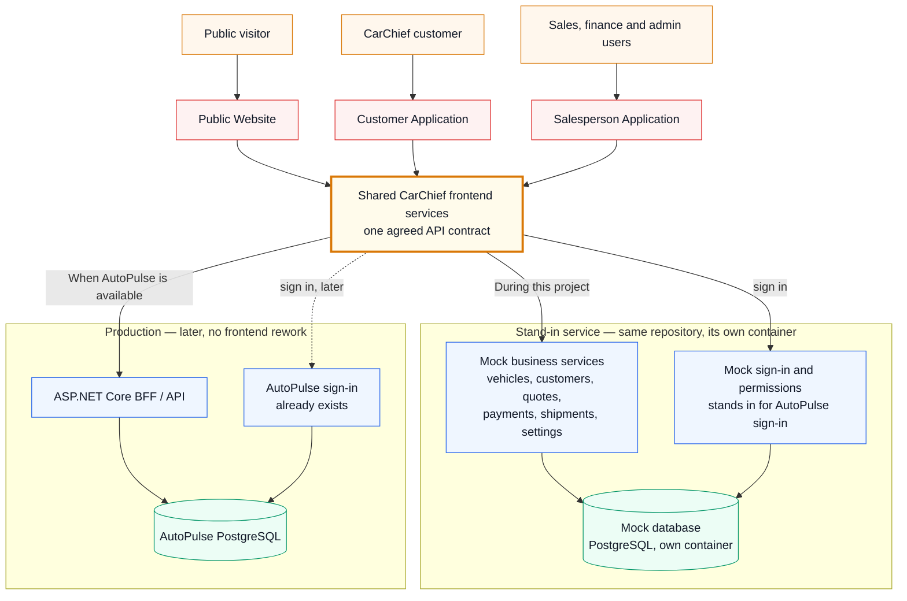
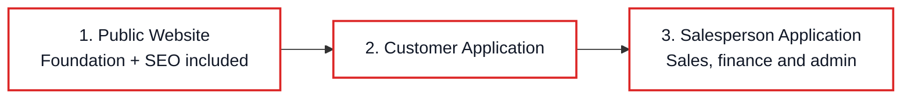
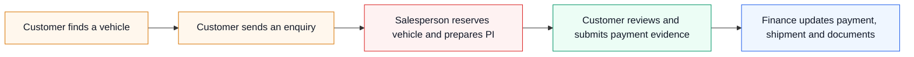
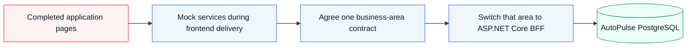
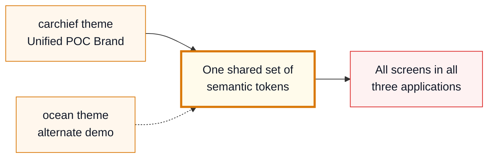

# CarChief Frontend Implementation Roadmap

## Management presentation

**Purpose:** Rebuild the CarChief POC as three production-quality applications delivered one at a time.
**Delivery order:** Public Website (including SEO) → Customer Application → Salesperson Application
**Build method:** Experienced engineers coordinate bounded AI agents, with daily human testing and review
**Base scheduled delivery:** **93.5 working days ≈ 18–19 calendar weeks**
**Programme allowance:** **2–3 weeks** for integration, review corrections, and accepted uncertainty
**Management planning range:** **20–22 calendar weeks**
**Detailed plan:** [CarChief Frontend Implementation Plan](./CarChief-Frontend-Implementation-plan.md)

### How a working day is spent

Every estimate in this document is built from the same simple daily pattern.

| Hours | Activity |
|---:|---|
| 5 | Building the software with an AI agent |
| 2 | Manual testing of what was built |
| 1 | Human review and sign-off |
| **8** | **Total working day** |

A "day" in every table below therefore means **five hours of building**, not eight. This is why the totals are lower than a traditional hand-built estimate but not dramatically so: testing and review still take real human time, and that time cannot be compressed by using an AI agent.

## 1. Executive summary

CarChief has a substantial proof of concept covering public vehicle discovery, customer self-service, and the work performed by sales, finance, and administration teams.

The production rebuild will be delivered application by application:

1. Complete and accept the Public Website.
2. Complete and accept the Customer Application.
3. Complete and accept the Salesperson Application, including its finance and administration modules.
4. Public SEO and public release-readiness checks are completed inside Delivery 1 before Customer Application delivery begins.

Each application is divided into small page- or component-focused phases. Every phase includes the screen, its supporting demonstration data, validation, tests, review, and a visible result. Mock services are extended only when the current page requires them.

All three applications are responsive. Common vehicle search and vehicle detail behavior is built once as reusable shared packages and configured for each audience, so customers, staff and public visitors do not receive three divergent search implementations.

All three applications will also be installable PWAs. The PWA baseline includes manifests, icons, an offline shell, online/offline indication, safe cache versioning, update prompts and logout cleanup. Sensitive records and financial or approval actions remain online-only; push notifications and background sync require a separate management decision.

Three things have been added to this plan since the previous version:

1. **The proof of concept was operated, not just read.** The earlier version of this document was written by reading the delivered demonstration files. The application has since been run and every screen used by hand. That exercise confirmed most of what was expected, and added a number of screens, options and business rules that were not visible from the files alone. Those additions are listed in section 2 and are now reflected in each delivery.
2. **A separate mock service is now explicit scope.** The applications need something to talk to before AutoPulse is available. That is now a small project of its own, described in section 3.
3. **The visual design becomes a theme.** The look and feel of the proof of concept is kept as the default `carchief` theme, with an `ocean` alternate proving that colours, fonts and spacing can be changed later without rebuilding screens.

The current **20–22-week** management range includes the newly decomposed Customer task set. Delivery 02 alone carries 25 planned task days plus a 15% review/correction allowance because customer source is missing and finance, document and identity decisions still require human authority.

## 1.1 What the BA workflow adds

The BA diagram shows that the customer journey starts before a vehicle appears in the showroom and continues after payment. It includes stock imports, country-specific pricing, support screening, negotiation, a separate PI payment window, finance exceptions, Ship OK and document release.

```mermaid
flowchart LR
    A["Procurement and bidding"] --> B["Import stock and images"]
    B --> C["Price ready / country visibility"]
    C --> D["Enquiry → support screening"]
    D --> E["Negotiation → customer confirmation"]
    E --> F["PI → 72-hour payment window"]
    F --> G["TT review → allocation"]
    G --> H["Ship OK → document release"]
    H --> I["Customer receives documents"]
```

Blue items represent CarChief screens and commands. Clear items are manual operations and green items are future third-party integrations, according to the BA legend. The supplied JSON contains no colour metadata, so ambiguous ownership must be confirmed before implementation. The existing application order remains Public Website (including SEO) → Customer Application → Salesperson Application.

## 2. What the re-audit confirmed

### Evidence levels

| Evidence | Meaning |
|---|---|
| **Source-confirmed** | Supported by the supplied TypeScript, configuration, utilities, or server source |
| **Compiled-artifact evidence** | Visible in a built HTML demonstration, but original source is missing |
| **Recommendation** | Proposed production approach rather than an existing POC capability |
| **Open question** | Requires a business, security, finance, AutoPulse, legacy, or BFF decision |

### Confirmed application coverage

| Application | Main capabilities found |
|---|---|
| Public Website | Home/showroom, inventory search, vehicle details and media, freight estimate, enquiry, customer login/reservation entry, About, How to Buy, Testimonials, FAQ and Contact |
| Customer Application | Compiled evidence for login, dashboard, showroom, sourced/reserved/invoiced vehicles, PI/invoices, TT payments, shipment tracking, documents, notifications and profile |
| Salesperson Application | Dashboard, global search, inventory/media, imports, leads, customers, reservations, PI/invoices, finance/allocation, exchange rates, masters, tiers, users/roles, branding and FAQ |

Representative source evidence: [`POC/src/App.tsx`](../POC/src/App.tsx), [`POC/src/types.ts`](../POC/src/types.ts), and [`POC/src/components/BackendDashboard.tsx`](../POC/src/components/BackendDashboard.tsx).

### Important limitations

- The available source uses Firebase Authentication and Firestore, not Supabase.
- The production frontend will use neither Firebase nor Supabase directly.
- Customer portal source, customer types/context, Firebase configuration, Firestore cache/instrumentation, and the audit component are missing.
- Detailed Customer Application behavior remains provisional until business owners approve it.
- PayPal, email, WhatsApp, AI, tracking, and download labels do not prove production vendor integration.
- Sensitive credential-like bootstrap behavior exists in the POC source and must be reviewed/rotated where applicable; no values are reproduced here.

### Additional details captured by the new plan

The page-level plan now explicitly includes:

- Customer theme/refresh, recovery, chassis search, notifications and unavailable-document behavior.
- Salesperson global search and configurable dashboard widgets.
- Salesperson bulk-TT entry and approved-payment banners.
- Staff and online reservation queues, expiry countdowns and duration settings.
- Categorized image ordering and public/customer visibility.
- PI-to-commercial-invoice conversion and invoiced/sold registries.
- Finance proof review, payment allocation and exchange-rate history.
- A clear distinction between functional screens and unproven external integrations.

### What operating the proof of concept added

The demonstration system was run and every screen used by hand. This confirmed the coverage above and added the following, none of which was visible from the delivered files alone. All of it is now built into the delivery phases.

**Public Website**

- Two separate search modes side by side: a standard filter panel and a natural-language search box with worked example questions.
- An expandable filter panel offering make, model, body type, year from/to, a price slider and fuel type, where the available choices are drawn from live stock rather than a fixed list.
- Three sort options: newest year, price low to high, price high to low.
- A manual "refresh stock" action on the stock listing.
- Individual vehicle pages that already work as their own web address and can be shared.
- A twelve-category question-and-answer section, customer testimonial submission, promotional banners and countdown timers.
- A contact page carrying multiple office locations and published operating hours.

**Customer Application**

- Nine areas in the customer's side menu: overview, browse stock, sourced vehicles, reserved vehicles, billed invoices, wire remittance, secure vault, bulletins and profile.
- A light/dark display switch and a manual "sync my data" action.
- Vehicles grouped into three folders — reserved, reserved with quotation, and invoiced — each showing its own count.
- A shipping-status filter across five stages: purchased, inspection, ready, in transit, delivered.
- A document area with ten named categories: proforma invoice, commercial invoice, bill of lading, inspection certificate, export certificate, insurance, packing list, vehicle photos, auction sheet and other.
- A displayed credit limit with utilisation against it.
- An automatically calculated 50% deposit figure shown on reserved vehicles.
- A profile area separating fixed identity fields from editable contact fields, with a password change.

**Salesperson Application**

- Five main areas: dashboard, inventory, leads, finance and master controls.
- Master controls contains ten separate administration screens: core configuration, spreadsheet upload, freight calculator, city delivery, customer tiers, customer management, roles, branding, questions-and-answers, and a system activity view.
- Finance is divided into three areas: customer payments, salesperson allocations and exchange rates.
- A dashboard carrying twelve performance figures, a monthly target gauge, a five-stage sales pipeline, six one-click actions, follow-up and hot-lead panels, a recommendations panel, a system activity log and three charts.
- The five sales pipeline stages: new leads, contacted, quotation issued, payment pending, completed.
- Six one-click actions: add customer, create lead, create quote, reserve vehicle, record bulk payment, view approved payment logs.
- Four actions on every stock row, plus an expandable panel of thirty-seven vehicle specifications.
- Quick specification presets for sports, luxury SUV and luxury sedan vehicles.
- A quotation builder in five sections with a live printable preview, per-field control over what appears on the printed document, seven trading currencies, a percentage tax basis, four international trade terms, salesperson assignment, selectable bank accounts and selectable standard terms.
- Twelve destination countries available on a quotation.
- A finance desk with date and status filters and its own notification panel.
- Six pre-loaded exchange rate pairs with an accompanying history view.
- A permissions matrix carrying twenty-nine individual permissions across four roles.
- Two spreadsheet upload modes: vehicle sourcing and shipment details.

**Business rules confirmed by operating the system**

| Rule | Detail |
|---|---|
| Vehicle statuses | Eight: draft, available, pending, reserved, reserved with quotation, invoice created, invoiced, sold |
| Lead statuses | Five: new (needs call), contacted (emailed), in progress (negotiation), sold (closed-won), archived (closed-lost) |
| Payment statuses | Three: pending, approved, rejected |
| Shipment statuses | Five: purchased, inspection, ready, in transit, delivered |
| Customer tiers | Platinum 15%, Gold 10%, Silver 5%, Standard 0% |
| Reservation hold | 48 hours by default, configurable |
| Deposit | 50% of vehicle price |
| Quotation cost lines | Vehicle price, freight, customs clearance, export inspection, port handling, insurance, plus a percentage tax basis |
| Trade terms | CNF, FOB, CIF, C&F |
| Currencies | US dollar, Japanese yen, euro, Ugandan shilling, British pound, Australian dollar, Canadian dollar |

### Behaviour we could not confirm

The following exist in the proof of concept but could not be exercised, because the demonstration data does not reach them or the feature is not connected. Each is marked **`UNABLE_TO_VERIFY_WITH_POC`** in the detailed plan and needs a business answer before the matching screen is built.

| Area | Why it could not be confirmed |
|---|---|
| Currency conversion end to end | Only same-currency payments exist in the demonstration data |
| Exchange rate history | No history records exist |
| Freight rate calculation | No freight rates are loaded and none can be added through the screen |
| City delivery rate calculation | No delivery rates are loaded |
| Import duty | No duty field exists anywhere; only a percentage tax basis |
| Spreadsheet import | No file could be uploaded to observe the result |
| Vehicle image management | The screen exists but was not reachable with demonstration data |
| Quotation to invoice conversion | No quotation reached that stage |
| Invoiced and sold registers | Not reachable with demonstration data |
| Salesperson allocations | No allocation records exist |
| Payment allocation action | The action exists but has no completed example |
| Reservation expiry | The 48-hour hold never elapsed during testing |
| Password recovery and multi-factor sign-in | Not present in the demonstration |
| Document upload to the customer vault | No documents exist and none could be added |
| Email and printed-document delivery | The actions exist but were not triggered |
| Staff global search | Not exercisable with demonstration data |
| Bulk payment entry and proof preview | No example records exist |
| PWA support | Installability, offline shell and safe cache lifecycle are now part of the target baseline; push/background-sync/camera/analytics remain open |

**This list is a strength, not a gap.** Each entry is a question we now know to ask before building, rather than an assumption discovered late.

## 3. Target solution

**Plain-language explanation:** The three applications never talk to a database directly. They talk to one agreed set of business services, described in a single shared document that both sides sign up to.

During this project those services are answered by a **stand-in service** — a fourth application kept alongside the other three, running in its own container with its own database. It behaves like the real thing: it stores what you save, returns what you ask for, and enforces who is allowed to see what.

CarChief staff and customers already sign in through AutoPulse in production. Because that system is not available to us yet, the stand-in service includes a **stand-in sign-in layer** that issues the same kind of pass and carries the same roles and permissions.

When AutoPulse is ready, the stand-in service is simply not deployed, and the real API and real sign-in take its place. **The three applications do not change** — they are pointed at a different address.

### How everything is packaged

Each of the four applications is delivered as its own self-contained unit, so they can be started, stopped, updated and deployed independently of one another.

| Unit | What it is |
|---|---|
| Public Website | Its own container |
| Customer Application | Its own container |
| Salesperson Application | Its own container |
| Stand-in service | Its own container, with a database container beside it |

In production, the last of these is simply not deployed. The three real applications are pointed at AutoPulse instead.

### Why the stand-in service sits in the same repository

| Reason | Benefit |
|---|---|
| The agreed API description and the service that answers it change together | A change to what the applications expect, and the matching update to the stand-in, arrive as one reviewed change instead of drifting apart |
| It is still a separate deployable unit | The applications reach it over the network, exactly as they will reach the real system |
| It is simply not deployed later, rather than removed | No clean-up work when the real system arrives |
| It uses the same database engine as AutoPulse (PostgreSQL) | What we prove in demonstration is what happens in production |
| It grows one screen at a time | We only ever build the parts a delivered screen actually needs |

**One thing to be aware of:** because it now lives beside the applications rather than in a separate project, the separation is no longer automatic and has to be actively enforced. Three controls do that — no application declares it as something it depends on, an automated rule rejects any attempt to use its code directly, and the production set of containers does not include it at all.

## 4. Delivery order

**Plain-language explanation:** One application is completed and accepted before the next becomes the primary delivery. The shared foundation, reusable vehicle packages and full public SEO are completed during the Public Website delivery.

## 5. Delivery 1 — Public Website

**Scheduled delivery:** 30.25 working days ≈ **6 weeks**
**Includes:** the shared foundation, reusable vehicle packages, the visual theme system, complete public SEO and the first working version of the mock service

**Production-site parity check:** A live public-site audit is now recorded in [the Legacy Public Website Audit](CarChief-Legacy-Public-Website-Audit.md). The newly reconciled [legacy business requirements](CarChief-Legacy-Public-Requirements-Reconciliation.md) add market/port-aware stock, date-driven arrival/location collections, Premium Stock and Branch pages. This means equivalent approved visitor capabilities—not copying legacy faults, unapproved content or third-party integrations.

The local stand-in API will include a Swagger page so engineers and supervisors can see and try the available mock operations. It is generated from the same contract used by the website, contains demo data only, and is disabled in production-like environments.

The detailed Delivery 01 task inventory and phase handoff outputs are maintained in [§5.10 of the engineering implementation plan](CarChief-Frontend-Implementation-plan.md#510-delivery-01-task-inventory-and-tangible-outputs). This supervisor roadmap keeps task IDs and engineering execution details in that linked document.

| Phase | Page/component delivery | Visible result | Days |
|---|---|---|---:|
| 1.1 | Shared foundation, reusable packages, POC theme parity, alternate theme, PWA and mock service start-up | Responsive shell, reusable vehicle-search/detail packages, PWA manifests/offline shell/update lifecycle, navigation, shared controls, loading/error states, the Unified POC Brand as default `carchief`, the `ocean` alternate, developer guide and a running mock service with sign-in | 10.25 |
| 1.2 | Home and showroom | Hero, market-aware latest/discounted/clearance collections, Premium Stock banner/teaser, country control, vehicle cards, public support actions, promotional banners, countdown timers and empty/loading states; corrective AI browser validation checks both themes and responsive sizes before review | 2.25 |
| 1.3 | Inventory and search page | Shared vehicle-search package consumed by the public app, country/port/category routes, server-returned Japan/transit/port location projection, two search modes, market-aware filters, manual refresh, results and no-results behavior | 3.5 |
| 1.4 | Vehicle details | Shareable vehicle web address, specifications, categorized media, status, approved price/price-request presentation, sharing and printing | 2.25 |
| 1.5 | Freight estimate and quotation enquiry | Destination selection, freight/city/insurance estimate and quotation enquiry | 2 |
| 1.6 | Enquiry, contact, authentication and reservation entry | Vehicle-preference/general enquiries, approved public support actions, customer access entry and reservation eligibility/conflict feedback | 1.75 |
| 1.7 | Public information and content | Company/services and Branch pages, stock/auction buying guidance, testimonials with submission, twelve-category FAQ, shipping schedule, approved policy content and Contact with offices/hours | 3.25 |
| 1.8 | Public SEO, PWA, acceptance and release readiness | Complete visitor journey, legacy PHP route templates/redirects, canonical URLs, sitemap, robots, metadata, structured data, PWA install/offline/update/security checks, responsive/accessibility/performance review and linked enquiry fixtures | 4.5 |
| — | Remaining correction allowance | Rework arising from testing and review after legacy-parity additions | 0.5 |

### Business outcome

A visitor can understand CarChief, find an appropriate vehicle, inspect it, estimate delivery, and contact or request a temporary hold from the sales team.

### Supervisor demonstration

Open the home page, select a market, review its Latest Arrivals and Premium teaser, browse market-eligible stock, open a vehicle page, calculate freight, submit an enquiry, open a Branch page, and view public auction/service/shipping/FAQ content.

### Important decisions

- Public vehicle fields and media.
- Approved company, inspection, customs, delivery and logistics claims.
- Freight, insurance and discount examples.
- Reservation duration and eligibility.
- Whether AI search or PayPal-labelled booking is required for launch.
- Which country/currency/language controls affect public stock or pricing, and which visible legacy pages/content are approved for launch.
- Whether Live Auction is an account-gated CarChief feature, an external destination or a retired route; which shipping-schedule source and support/CAPTCHA providers are approved.
- Country/port mapping, IP-detection privacy/fallback, J/CRFO definitions/order, Premium eligibility, and Branch meaning/content ownership.
- Acceptance of the Unified POC Brand as `carchief`, the `ocean` alternate, and the theme-switching configuration documented for developers.

### Acceptance

- Public/private information is correctly separated.
- Search, vehicle URLs, freight examples and forms work on supported devices.
- Critical public accessibility and automated journeys pass.
- Every approved legacy public page template is accounted for by a responsive route, redirect, explicit retirement decision or content-owner decision; legacy server-error pages are not reproduced.
- Public Website scope, including the corrected shared theme foundation and alternate-theme demonstration, is accepted before Customer Application delivery becomes primary.

## 6. Delivery 2 — Customer Application

**Planned task capacity:** 25 working days; with a 15% review/correction allowance, approximately **29 working days or 5–6 calendar weeks**.
**Evidence caution:** The customer application was delivered only as a finished demonstration, with no underlying source. Every screen here was established by operating the running system, and each needs business confirmation before it is built.

Engineering execution is defined by 42 AI-executable files across nine phases: 29 implementation/acceptance tasks, four decision/scope gates and nine phase PR-review gates. See the [Delivery 02 coverage matrix](../tasks/delivery_02/DELIVERY_02_COVERAGE_MATRIX.md), [execution order](../tasks/EXECUTION_ORDER.md) and [Excel-importable task list](../tasks/delivery_02/CarChief-Delivery-02-Tasks.csv).

| Phase | Page/component delivery | Visible result | Days |
|---|---|---|---:|
| 2.1 | Customer scope, shell and account access | Approved compiled scope, sign-in through the mock service, protected navigation, themes, PWA shell and account states | 3 |
| 2.2 | Customer dashboard | Tier/account, reconciled vehicle, shipment, invoice, payment, alert and approved credit figures | 1.5 |
| 2.3 | Customer showroom and vehicle search | Shared search/detail experience, customer-visible stock, tier pricing and reservation eligibility | 2.25 |
| 2.4 | My Vehicles | Reserved, reserved with PI and invoiced groupings with unique counts, approved shipping filters and deposit | 2.25 |
| 2.5 | Quotes and invoices | Quotation and invoice views, totals, paid and outstanding, print and download | 2 |
| 2.6 | Payments, TT remittance and PI deadline | Journal/submission, held/resubmitted/approved/allocated states, proof policy and payment deadline | 4 |
| 2.7 | Shipment tracking and secure documents | Shipment exceptions, Ship OK/document release and approval-gated ten-category vault | 4 |
| 2.8 | Notifications and profile | Linked read/unread alerts, fixed/editable profile fields and identity handoff | 2 |
| 2.9 | Customer Application acceptance | Traceability, isolation/security, accessibility/PWA/performance, Docker UAT and Delivery 03 handoff | 4 |
| — | Review/correction allowance | 15% for human/AI review findings, accepted-scope corrections and cross-feature reconciliation | 3.75 |

### Business outcome

Customers can understand their vehicles, quotes, invoices, payments, shipment progress, documents and notifications without repeatedly asking staff for updates.

### Supervisor demonstration

Sign in as a customer, search eligible stock, inspect reserved/invoiced vehicles, review the PI and outstanding balance, submit TT evidence, track shipment progress, open an allowed document, read a notification and update contact details.

### Important decisions

- Final customer page inventory from the compiled artifact.
- Identity, recovery and MFA.
- Customer ownership and editable profile fields.
- Credit/tier/dashboard definitions.
- Payment-proof, document and KYC storage/retention.
- Shipment status source and live-tracking requirement.

### Acceptance

- Business owners sign off every compiled-only page.
- Customers cannot access another customer’s data or documents.
- Dashboard/invoice/payment totals reconcile with linked records.
- Customer Application scope is accepted before Salesperson Application delivery becomes primary.

## 7. Delivery 3 — Salesperson Application

**Scheduled delivery:** 35 working days ≈ **7 weeks**

The application retains the business name "Salesperson Application," but permission-controlled finance and administration modules remain inside it.

| Phase | Page/component delivery | Visible result | Days |
|---|---|---|---:|
| 3.1 | Staff access and dashboard | Role-aware sign-in and navigation, twelve performance figures, monthly target gauge, five-stage pipeline, six one-click actions, follow-up and hot-lead panels, activity log, three charts and global search | 3 |
| 3.2 | Inventory management | Search and status views, vehicle create/edit/remove, thirty-seven-specification panel, quick specification presets, media, visibility, reservation queues and countdowns | 4 |
| 3.3 | Vehicle and shipment imports | Two spreadsheet upload modes, validation, preflight, row correction, reference matching and controlled commit | 2 |
| 3.4 | Leads and customer management | Lead assignment, five-stage status, internal notes, plus customer search, create, edit, tier and assignment | 2.5 |
| 3.5 | Reservations and proforma invoices | Reserve, release and expiry; five-section quotation builder with live printable preview, per-field print control, seven currencies, tax basis, four trade terms, twelve destinations, salesperson assignment, bank and terms selection | 5 |
| 3.6 | Sales registries and customer visibility | Quotation-to-invoice conversion, invoiced and sold records, balances, portal visibility and communication intent | 1.5 |
| 3.7 | Payments and finance | Three finance areas, bulk payment entry, proof review, approval and rejection, allocation that cannot be double-spent, six exchange rate pairs with history, and a finance notification panel | 3 |
| 3.8 | Operational masters and logistics rates | Six master lists, freight and city-delivery rates, and a working way to load standard starting rates | 2.5 |
| 3.9 | Customer tiers | Credit, payment and reservation limits, and elapsed-week discounts | 1 |
| 3.10 | Users, roles and permissions | User directory, role assignment, custom roles and a twenty-nine-permission matrix across four roles | 1.5 |
| 3.11 | Branding, FAQ and audit | Branding, twelve-category FAQ administration and system activity presentation | 1 |
| 3.12 | Salesperson Application acceptance | Complete cross-application sales, finance and administration demonstration and regression | 1.5 |
| — | Correction allowance | Rework arising from testing and review | 6.5 |

### Business outcome

Sales, finance and authorized administration users can manage the complete operational journey from enquiry and stock through reservation, invoice, payment allocation and customer-visible updates.

### Supervisor demonstration

Receive the Public Website enquiry, assign it, create/select the customer, reserve the vehicle, issue a PI, show it in the Customer Application, record and approve TT funds, allocate payment, update the transaction, and show shipment/document/notification changes to the customer.

The demonstration will also show vehicle CSV preflight, a freight/master change, a customer tier, a role permission, FAQ/branding administration, and a conditional audit event.

### Important decisions

- Vehicle field dictionary, statuses and CSV templates.
- Lead/customer assignment and KYC privacy.
- Reservation and PI rules.
- Money precision, exchange rates, payment approval/allocation and sold status.
- Master-data ownership and historical behavior.
- Roles, finance separation and identity administration.
- Email, WhatsApp, AI and other launch integrations.

### Acceptance

- Role and customer-ownership tests pass.
- Inventory/import and sales workflows behave consistently.
- Approved PI and finance examples reconcile.
- External-integration buttons are not presented as completed services unless separately implemented.
- The connected three-application journey is accepted.

## 8. End-to-end customer journey

**Plain-language explanation:** The applications are delivered separately, but their demonstration data remains connected. An enquiry created in the Public Website becomes the customer, reservation, invoice, payment and shipment story used by the later applications.

### 7.1 Additional visible business outcomes

The Customer Application task set now explicitly covers PI/payment deadlines, held or re-submission-required payments, allocation/remaining balance, Ship OK and document-release status. The Salesperson Application must later cover support-screened leads, country assignment, negotiation and PI timers, TT review exceptions, payment allocation, Ship OK approval and document-release approval. Delivery 02 is re-estimated at 5–6 calendar weeks; later Salesperson re-estimation still depends on its task audit.

## 9. SEO within Public Website delivery

SEO is no longer a separate delivery. It is completed in Phase 1.8 as part of the Public Website, before the Customer Application begins.

## 10. Timeline, staffing and estimate comparison

| Calendar window | Primary delivery | Working days | Scheduled time |
|---|---|---:|---:|
| Weeks 1–6 | Public Website, shared foundation, POC theme parity, reusable packages, mock service and SEO | 29.75 | 6 weeks |
| Weeks 6–11.8 | Customer Application | 28.75 | 5–6 weeks |
| Weeks 11.8–18.8 | Salesperson Application | 35 | 7 weeks |
| | **Base scheduled delivery** | **93.5** | **≈ 18–19 weeks** |
| Distributed where required | Programme allowance | | **2–3 weeks** |
| | **Management planning range** | | **20–22 weeks** |

### Why the estimate changed

The previous task-level figure was 18–20 weeks. The current figure is 20–22 weeks because the Customer delivery now explicitly includes decision gates, secure payment/document failure paths, Docker acceptance and one PR review per phase.

**What made it shorter**

- Each delivery is built by an AI agent rather than written by hand. Five hours of agent-assisted building covers noticeably more ground than five hours of manual coding.
- The demonstration system was operated screen by screen, so the behaviour to build is already known. The previous plan carried time for working out what each screen was supposed to do.
- The search-engine delivery shrank, because individual vehicle pages already work as shareable addresses.

**What made it longer**

- The mock service is now explicit scope: its own project, its own container, its own database, and a stand-in sign-in layer.
- The visual design is now built as a swappable theme rather than fixed styling.
- Eighteen areas of behaviour could not be confirmed from the demonstration and carry a business-answer step before building.
- Testing and review remain human work. Three of every eight hours are spent this way, and no tool compresses that.

### Staffing assumption

- One accountable person driving the AI agent, testing daily, and reviewing daily.
- Part-time product, business, design, security and finance input for approvals.
- Business decisions and demonstration feedback normally available within one working day.

The AI agent performs bounded implementation. The accountable human remains responsible for architecture, calculations, security, privacy, accessibility, acceptance and release.

**A note on adding people.** Because the daily pattern is fixed at five hours of building, two hours of testing and one hour of review, adding a second person roughly halves the calendar only where work can be split cleanly. Delivery 3 splits well. The shared foundation in Delivery 1 does not.

## 11. Moving from mocks to AutoPulse

**Plain-language explanation:** The page does not need to be rebuilt when its real API becomes available. CarChief agrees and tests one business area at a time, then changes the service behind the page from mock data to the BFF.

Production will never silently use mock services. Deterministic mocks remain available for engineering tests and demonstrations.

### What the mock service is, in practice

| Question | Answer |
|---|---|
| Where does it live? | In the same repository as the three applications, alongside them as a fourth application. |
| Is it part of the applications? | No. It is packaged and deployed separately, in its own container. The applications reach it over the network, never by using its code. |
| Why keep it in the same repository? | The agreed API description and the service that answers it change together, so both arrive as one reviewed change rather than drifting apart across two projects. |
| What stops an application depending on it by mistake? | No application declares it as a dependency, an automated rule rejects any attempt to use its code, and the production container set does not include it. |
| What is it built with? | A small Node.js service, kept deliberately simple so it is cheap to extend. |
| Where does it store data? | Its own PostgreSQL database in its own container — the same engine AutoPulse uses, so behaviour matches production. |
| Why not something simpler? | The system has around two dozen connected record types. Anything simpler cannot enforce that a payment already spent on one vehicle is not spent again on another. |
| How do the two sides agree? | One shared document describes every service, request and response. The stand-in implements it; the applications are built against it; the real API later implements the same document. |
| How does sign-in work? | It issues the same kind of pass AutoPulse will issue, carrying the person's role and permissions. |
| How does it grow? | One screen at a time. We add only the services the screen being delivered actually needs. |
| What happens to it at the end? | It is simply not deployed to production. It stays in the repository for testing and demonstrations. |

### Sign-in, now and later

CarChief already has a sign-in system inside AutoPulse, and production will use it. We do not have access to it during this project, so the mock service includes a stand-in that behaves the same way from the applications' point of view: a person signs in, receives a pass, and that pass carries their role and permissions.

Because the applications only ever see the pass — never the system that issued it — switching to the real AutoPulse sign-in is a configuration change, not a rebuild.

## 11a. Keeping the look, but making it changeable

The new applications will look like the proof of concept. That visual direction is approved and familiar, and there is no reason to redesign it.

The difference is how it is built. Instead of fixing colours, fonts and spacing into each screen, they are defined once in a single named theme. Screens refer to "the primary action colour" rather than to a specific shade of red.

**What this buys CarChief:** the familiar POC look is the default, while a future rebrand, partner-branded version or light/dark surface variant becomes a registry/configuration change rather than a pass over every screen. The customer application in the proof of concept already offers a light/dark switch, so surface variants are expected behaviour rather than a speculative addition. Developers can follow [`DEVELOPER_USER_GUIDE.md`](../DEVELOPER_USER_GUIDE.md) to switch between `carchief` and `ocean`.

**Cost:** roughly half a day inside the shared foundation phase. It is far cheaper to do at the start than to retrofit.

## 12. Principal decisions and risks

### Management decisions

1. Confirm or supply the missing customer, Firebase, cache and audit source.
2. Confirm why the source uses Firebase/Firestore rather than the earlier Supabase description.
3. Approve customer pages visible only in compiled output.
4. Select production identity, recovery, MFA, roles and finance separation.
5. Approve statuses and worked pricing, freight, tax, currency and allocation examples.
6. Approve public/customer/staff field and media visibility.
7. Approve document, KYC and payment-proof storage, scanning, privacy and retention.
8. Approve vehicle/CSV field mapping and import policy.
9. Decide launch integrations and fund them separately.
10. Provide final domains, public claims and legacy PHP URLs.
11. Assign content, master-data, finance, security, UAT and release owners.
12. Confirm the BA diagram colour ownership for ambiguous nodes; the JSON export does not preserve colours.
13. Confirm whether negotiation and reservation timers are the same, and define expiry outcomes.
14. Confirm the 72-hour PI payment window and vehicle-hold behavior.
15. Confirm Active/Deactive/Now On Sale meanings, country visibility and price-request routing.
16. Confirm whether CSV, auction media, bank checks, ERP/IBQ, email and WhatsApp remain manual for MVP.
17. Confirm Ship OK and document-release approvers, rejection paths and customer-visible status names.
18. Confirm second-payment behavior and document-release timing.
19. Confirm whether push notifications, background sync, camera/file capture and install analytics are required beyond the PWA baseline.

### Principal risks and controls

| Risk | Control |
|---|---|
| Customer source is missing | Require business sign-off for every compiled-only page before acceptance |
| POC and AutoPulse fields differ | Confirm each business-area contract against AutoPulse before BFF integration |
| Browser security patterns are copied | Use a clean implementation and authoritative BFF authorization |
| Financial rules differ between teams | Approve worked examples and automate them |
| Vehicle/CSV scope expands | Approve the field dictionary and templates early |
| Integration labels are mistaken for working vendors | Maintain a separate approved launch-integration list |
| Documents, KYC or proofs are mishandled | Approve storage, scanning, access, privacy, retention and audit policies |
| AI-agent output exceeds review capacity | Use bounded tasks, mandatory human review and automated gates |
| App-first delivery delays end-to-end discovery | Maintain linked fixtures and run a connected demo at each application acceptance |
| Upstream and approval workflow is under-specified | Resolve the BA workflow decision gate before generating Customer/Salesperson tasks and re-estimate |
| Manual or external steps are mistaken for automation | Label them as checkpoints/integration intent and never claim completion without evidence |

## 13. Exclusions

- ASP.NET Core BFF development.
- AutoPulse schema changes, data migration and operational data cleansing.
- Production identity-provider implementation or account migration.
- Final copywriting, translations, photography and media production.
- Live payment, email, WhatsApp, AI, carrier tracking, scanning, analytics or other vendor integration implementation.
- External legal, privacy, compliance, certification or penetration-testing work.

## 14. What management will receive

- A completed and accepted Next.js Public Website.
- A completed Customer Application with business-confirmed scope.
- A completed Salesperson Application containing sales, finance and administration modules.
- A connected enquiry-to-payment-to-shipment demonstration journey.
- Incremental, realistic mock services with repeatable reset.
- Automated tests for critical workflows and approved calculations.
- Public SEO completion and release-readiness evidence are accepted inside Delivery 1 before the later applications are primary.
- A documented migration path to the ASP.NET Core BFF and AutoPulse.
- UAT, release, support, risk and decision documentation.

The component-level scope, evidence, dependencies, mock services, tests and acceptance criteria are available in the [CarChief Frontend Implementation Plan](./CarChief-Frontend-Implementation-plan.md).

## 15. Conclusion

This is the delivery in one table: four things are built, one at a time, each one usable and reviewable before the next begins.

| # | Delivery | What we are delivering | Summary | Timeline (days) |
|---|---|---|---|---:|
| 1 | Public Website (including SEO) | A responsive public website where anyone can browse market-eligible stock, Premium Stock and Branch pages, search, inspect and enquire about vehicles for sale. Includes reusable vehicle packages, the shared design foundation, Unified POC Brand default theme, `ocean` alternate theme, complete public SEO and the first working version of the separate mock service. | The shop window. No sign-in required. This is what a prospective buyer sees first. | 29.75 |
| 2 | Customer Application | A private, sign-in-protected area where an existing CarChief customer can see their vehicles, quotations, invoices, payments, shipment progress and documents. | The customer's own account. Answers "where is my car and what do I owe." | 28.75 |
| 3 | Salesperson Application | The internal system used every day by sales, finance and administration staff to manage leads, stock, quotations, payments, master data, users and permissions. | The engine room. Where enquiries become sales and money gets tracked. | 35 |
| | | | **Base total** | **93.5** |
| | | | **With programme allowance** | **≈ 101–106** |

**In calendar time:** roughly **18–19 weeks** of scheduled application work and **20–22 weeks** once programme uncertainty is included. Delivery 02 assumes two experienced engineers coordinate bounded AI agents while retaining human authority for architecture, finance/security decisions, QA and phase PR approval.

The open questions behind that allowance — including everything we could not confirm by operating the demonstration system ourselves — are tracked in [`implementation_risks.md`](./implementation_risks.md).
