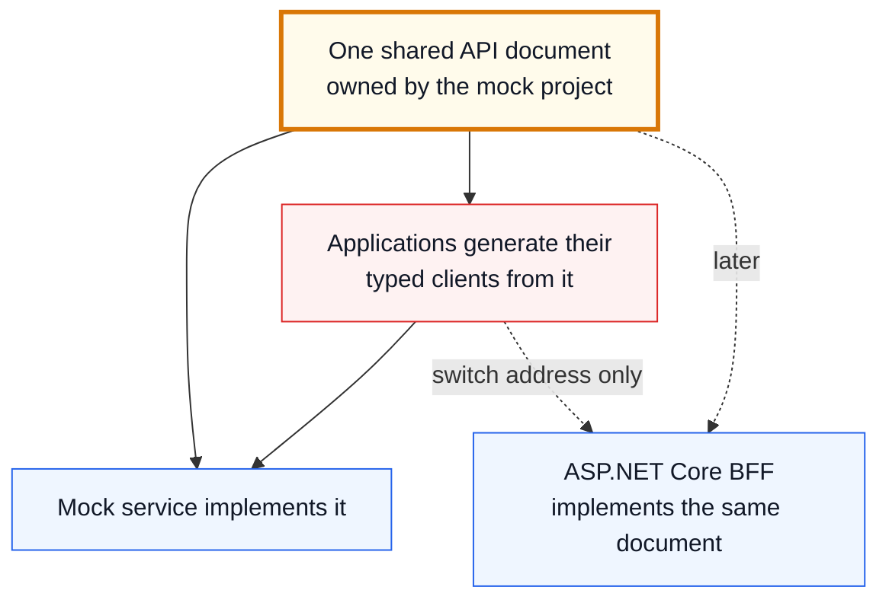

# CarChief Frontend Implementation Plan

**Document purpose:** Page- and component-level engineering delivery plan
**Discovery basis:** Re-audit of the full source project and compiled artifacts under `POC/`, **plus hands-on operation of the running demonstration system, screen by screen**
**Delivery order:** Public Website → Customer Application → Salesperson Application → SEO Completion and Release Readiness
**Base scheduled delivery:** **79 working days ≈ 16 calendar weeks**
**Programme allowance:** **2–3 weeks** for integration, review corrections, and accepted-scope uncertainty
**Management planning range:** **18–19 calendar weeks**
**Delivery model:** Each phase is built by an AI agent, driven, tested and reviewed daily by one accountable person

> This is a frontend delivery plan. It does not approve a database design, accounting policy, identity platform, external vendor, or final ASP.NET Core BFF wire contract.

## 1. Executive summary

The CarChief POC demonstrates a broad vehicle-export operation across three user experiences: a public website, a customer application, and a staff application containing sales, finance, and administration functions. The POC is valuable evidence for screens, workflows, calculations, statuses, and visual behavior, but it should not be converted directly into production code.

The supplied source is a large React/Vite single-page application that accesses Firebase Authentication and Firestore from browser components. It is not Supabase-based in the available revision. Important authorization, calculation, identity-administration, and multi-record update logic currently runs in the browser. The customer TypeScript source, Firebase configuration, Firestore cache layer, and Firestore audit component are missing.

The target will be a clean React/TypeScript implementation with:

- A Next.js public website.
- A React customer application.
- A React Salesperson Application that also contains the confirmed finance and administration modules.
- Shared packages for UI, domain definitions, validation, frontend service contracts, adapters, incremental mock services, testing, and configuration.
- No direct Firebase, Supabase, PostgreSQL, credential, or privileged identity dependency in frontend code.

Delivery is organized by application rather than by a cross-application workflow. The Public Website is completed and accepted first, the Customer Application second, the Salesperson Application third, and full SEO plus final release readiness last. Components may be developed in parallel within the active application, but the next application does not become the primary delivery stream until the previous application passes its acceptance phase.

## 2. Evidence and estimation conventions

### 2.1 Evidence labels

- **Source-confirmed:** Supported by supplied TS/TSX, configuration, utility, or server source.
- **Compiled-artifact evidence:** Visible in a built HTML artifact, but the original source is missing or unavailable.
- **Runtime-confirmed:** Observed working by operating the running demonstration system by hand. The strongest evidence available, and the only kind available for the Customer Application.
- **`UNABLE_TO_VERIFY_WITH_POC`:** Present in the demonstration but impossible to exercise — the data never reaches it, or the feature is not connected. **Requires a business answer before the matching screen is built.**
- **Recommendation:** Proposed production behavior or architecture rather than a POC claim.
- **Open question:** Requires confirmation from management, business, legacy, AutoPulse, security, finance, or the BFF team.

### 2.2 Estimate labels

Each delivery phase is built by an AI agent, driven and checked by one accountable person. Every working day follows the same fixed pattern:

| Hours | Activity |
|---:|---|
| 5 | Building the software with an AI agent |
| 2 | Manual testing of what was built |
| 1 | Human review and sign-off |
| **8** | **Total working day** |

- **Phase days** means whole working days on that pattern — so **five hours of building per day**, not eight.
- Phase days include the screen, its slice of the mock service, automated tests, manual testing, review and demonstration preparation.
- A correction allowance is carried per delivery rather than inflating individual phases.
- Application delivery order remains sequential. Phases inside a delivery may overlap only where they do not share files.

### 2.3 Estimate result

| Delivery | Phase days | Correction allowance | Total days | Calendar |
|---|---:|---:|---:|---:|
| Public Website (incl. foundation, theming, mock service start-up) | 19.5 | 2 | **21.5** | 4.5 weeks |
| Customer Application | 16 | 2 | **18** | 3.6 weeks |
| Salesperson Application | 28.5 | 6.5 | **35** | 7 weeks |
| SEO Completion and Release Readiness | 3.5 | 1 | **4.5** | 1 week |
| **Base scheduled delivery** | **67.5** | **11.5** | **79** | **≈ 16 weeks** |
| Programme allowance | | | | **2–3 weeks** |
| **Management planning range** | | | | **18–19 weeks** |

**Why this differs from the previous 21–22 weeks.**

Shorter because: each phase is built by an AI agent rather than hand-written; the demonstration system has now been operated screen by screen, so the behaviour to build is known rather than inferred; and the SEO delivery shrank once it was confirmed that vehicle pages already work as shareable web addresses.

Longer because: the mock service is now explicit scope with its own project, container, database and stand-in sign-in layer; the visual design is built as a swappable theme; eighteen areas carry an `UNABLE_TO_VERIFY_WITH_POC` question that must be answered before building; and testing and review remain human work at three hours of every eight.

## 3. Re-audit findings

### 3.1 Current architecture and source limitations

**Source-confirmed:** React 19, TypeScript, Vite, Tailwind CSS, Firebase, Motion, Lucide, Express, and Google GenAI appear in [`POC/package.json`](../POC/package.json). The current browser application directly accesses Firestore through [`POC/src/App.tsx`](../POC/src/App.tsx) and feature components. The small Express server provides only AI inventory search and FAQ endpoints in [`POC/server.ts`](../POC/server.ts).

The following imported modules are absent:

- `POC/src/customer/CustomerPortalApp`
- `POC/src/customer/contexts/CustomerPortalContext`
- `POC/src/customer/types`
- `POC/src/firebase`
- `POC/src/lib/firestoreCache`
- `POC/src/components/FirestoreAuditPanel`

Consequences:

- Customer pages are compiled-artifact evidence until confirmed.
- Firebase initialization and security rules cannot be assessed.
- Cache/listener behavior cannot be assessed.
- The audit page is intended but cannot be treated as a complete source-confirmed feature.
- Sensitive credential-like bootstrap behavior exists in client source and must be reviewed/rotated where applicable; no values are reproduced here.

### 3.2 Coverage gaps corrected by this rewrite

The previous documents covered the main domains but compressed or omitted the following details:

- Public home preview sections, interactive How to Buy presentation, content claim approval, and testimonial submission.
- Vehicle media visibility by auction, auction sheet, Japan, and Durban categories.
- Share/print behavior and duplicated vehicle detail page/modal behavior requiring consolidation.
- PayPal-labelled booking, email, WhatsApp, AI, and download buttons as integration intent rather than proven production integration.
- Customer theme, manual refresh, password recovery, search by chassis, filtered sourced/reserved/invoiced views, notification controls, and unavailable-document states.
- Salesperson global search across customers, vehicles, and invoices.
- Reorderable/maximizable dashboard widgets, charts, hot leads, follow-ups, AI-labelled insights, targets, and commission assumptions.
- Salesperson bulk-TT entry and approved-TT notification/banner behavior.
- Separate staff and online reservation queues, countdown timers, and configurable reservation/PI durations.
- Media ordering, visibility, image URL/upload behavior, and POC-only preset-image shortcuts.
- Proforma-to-commercial-invoice conversion and portal-visibility controls in invoiced/sold registries.
- Staff notification read/delete behavior and finance proof preview/filtering.
- The PWA/service-worker implementation as source evidence but not an approved target requirement.

### 3.2a What operating the demonstration system added

The previous version of this plan was written from the delivered files. The system has since been run and every screen used by hand. That confirmed most of the coverage above and added the following, which is now built into the phases.

**Public Website**

- Two search modes presented side by side: standard filters and a natural-language box with worked example questions.
- An expandable filter panel — make, model, body type, year from/to, price slider, fuel type — where the options are **derived from live stock**, not a fixed list.
- Three sort orders: newest year, price ascending, price descending.
- A manual stock-refresh action on the listing page.
- Vehicle pages that already function as individual shareable web addresses.
- Twelve FAQ categories, testimonial submission, promotional banners and countdown timers.
- A contact page carrying multiple offices and published operating hours.

**Customer Application** *(runtime-confirmed; no source exists)*

- Nine navigation areas: overview, browse stock, sourced vehicles, reserved vehicles, billed invoices, wire remittance, secure vault, bulletins, profile.
- A light/dark display switch and a manual data-sync action.
- Vehicle folders — reserved, reserved with quotation, invoiced — each carrying its own count.
- A five-stage shipping filter: purchased, inspection, ready, in transit, delivered.
- Ten named document categories in the vault.
- Credit limit displayed with utilisation against it.
- An automatically derived 50% deposit figure on reserved vehicles.
- A profile separating fixed identity fields from editable contact fields, plus password change.

**Salesperson Application**

- Five primary areas; master controls subdivides into ten administration screens; finance subdivides into three.
- A dashboard carrying twelve performance figures, a monthly target gauge, a five-stage pipeline, six one-click actions, follow-up and hot-lead panels, an activity log and three charts.
- Pipeline stages: new leads → contacted → quotation issued → payment pending → completed.
- One-click actions: add customer, create lead, create quote, reserve vehicle, record bulk payment, approved payment logs.
- Four actions per stock row, plus a thirty-seven-field specification panel and quick presets for sports, luxury SUV and luxury sedan.
- A five-section quotation builder with live printable preview, per-field control over what prints, seven trading currencies, a percentage tax basis, four trade terms, twelve destinations, salesperson assignment, and selectable bank accounts and standard terms.
- A finance desk with date and status filters and its own notification panel.
- Six exchange rate pairs with a history view.
- A twenty-nine-permission matrix across four roles.
- Two spreadsheet upload modes: vehicle sourcing and shipment details.

**Business rules confirmed at runtime**

| Rule | Values |
|---|---|
| Vehicle status | Draft · Available · Pending · Reserved · Reserved with PI · Invoice Created · Invoiced · Sold |
| Lead status | New (Needs Call) · Contacted (Emailed) · In Progress (Negotiation) · Sold (Closed-Won) · Archived (Closed-Lost) |
| Payment status | Pending · Approved · Rejected |
| Shipment status | Purchased · Inspection · Ready · In Transit · Delivered |
| Customer tiers | Platinum 15% · Gold 10% · Silver 5% · Standard 0% |
| Reservation hold | 48 hours default, configurable |
| Deposit | 50% of vehicle price |
| Quotation cost lines | Vehicle price, freight, customs clearance, export inspection, port handling, insurance, plus percentage tax basis |
| Trade terms | CNF · FOB · CIF · C&F |
| Currencies | USD · JPY · EUR · UGX · GBP · AUD · CAD |
| Roles | Admin (Super Admin) · Dealer (Partner Dealer) · Sales (Sales Representative) · Guest (Showroom Guest) |

### 3.2b `UNABLE_TO_VERIFY_WITH_POC` register

Each item below exists in the demonstration but could not be exercised — the data never reaches it, or the feature is not connected. **Each requires a business answer before the matching phase begins.** They are repeated against their phases in sections 5–8.

| # | Area | Reason it could not be verified | Phase |
|---|---|---|---|
| UV-1 | Currency conversion end to end | Only same-currency payments exist in demonstration data | 3.5, 3.7 |
| UV-2 | Exchange rate history | No history records exist | 3.7 |
| UV-3 | Freight rate calculation | No rates loaded; none can be added through the screen | 1.5, 3.8 |
| UV-4 | City delivery rate calculation | No rates loaded | 1.5, 3.8 |
| UV-5 | Import duty | No duty field exists; only a percentage tax basis | 3.5 |
| UV-6 | Spreadsheet import behaviour | No file could be uploaded to observe the result | 3.3 |
| UV-7 | Vehicle image management | Screen exists but was not reachable with demonstration data | 3.2 |
| UV-8 | Quotation-to-invoice conversion | No quotation reached that stage | 3.6 |
| UV-9 | Invoiced and sold registers | Not reachable with demonstration data | 3.6 |
| UV-10 | Salesperson allocations | No allocation records exist | 3.7 |
| UV-11 | Payment allocation action | Action exists but has no completed example | 3.7 |
| UV-12 | Reservation expiry | The 48-hour hold never elapsed during testing | 3.5 |
| UV-13 | Password recovery and multi-factor sign-in | Not present in the demonstration | 2.1 |
| UV-14 | Document upload to the customer vault | No documents exist and none could be added | 2.7 |
| UV-15 | Email and printed-document delivery | Actions exist but were not triggered | 2.5, 3.5 |
| UV-16 | Staff global search | Not exercisable with demonstration data | 3.1 |
| UV-17 | Bulk payment entry and proof preview | No example records exist | 3.7 |
| UV-18 | Offline behaviour and installable app | Present in the files but not an approved requirement | 4.4 |

### 3.3 Features not promoted to production requirements automatically

- POC hard-coded monthly targets, fallback dashboard numbers, and 2.5% commission.
- Preset Unsplash image generation shortcuts.
- AI search, AI recommendations, and AI FAQ as required launch integrations.
- PayPal-labelled booking, email dispatch, WhatsApp messaging, or live carrier tracking.
- Browser-side user creation/password administration.
- Raw SVG injection.
- Offline-first behavior or broad service-worker caching.
- Remarks and bank-notes master tabs that are named in state but have no rendered source page.

These remain open questions or demonstration-only behavior until explicitly approved.

## 4. Target frontend and service boundaries

### 4.1 Applications

#### Public Website

- Next.js App Router.
- Public home, inventory, vehicle details, freight estimate, enquiry/reservation entry, and information/content pages.
- Server-renderable semantic routes from the first delivery.
- Only explicitly public vehicle fields and media.

#### Customer Application

- Authenticated React/TypeScript client.
- Customer dashboard, showroom, vehicles, quotes/invoices, payments, shipments, documents, notifications, and profile.
- Customer ownership and document visibility ultimately enforced by the BFF.

#### Salesperson Application

- Authenticated React/TypeScript client.
- Sales dashboard, inventory, imports, leads, customers, reservations, PI/invoices, finance, masters, tiers, users, roles, content, and audit presentation.
- “Salesperson Application” is the business-facing name; finance and administration remain permission-controlled modules inside it.

### 4.2 Repository layout

One repository holds all four applications and the code they share. Each application is deployed as its own container; the shared packages are compiled into those containers and are never deployed on their own.

```text
apps/                      Each of these becomes its own container
  public-web/                Public website
  customer-app/              Customer application
  salesperson-app/           Salesperson application
  mock-api/                  Stand-in backend service (see 4.4)

packages/                  Shared code, compiled into the applications above
  ui/                        Shared screen components
  theme/                     Colours, fonts, spacing (see 4.5)
  domain/                    Shared business types and rules
  validation/                Shared field-checking rules
  api-client/                The only place that calls the API
  testing/                   Shared test data and helpers
  config/                    Shared build and quality settings

openapi/                   The agreed API description
docker/                    Container definitions for local and production use
```

Full technical detail of this structure — including where container definitions and environment files live — is in [`FRONT_END_ARCHITECTURE.md`](../FRONT_END_ARCHITECTURE.md).

### 4.3 Frontend service rule

Screens call typed domain service interfaces. Environment composition selects an incremental mock adapter during frontend delivery and an ASP.NET Core HTTP adapter during BFF integration. Screens do not import mock handlers or transport clients directly.

For each component phase:

1. Define only the service operations needed by its visible workflow.
2. Add linked fixtures, validation, persistence, reset, and relevant failure scenarios.
3. Test the component and service contract together.
4. Record unresolved BFF/AutoPulse fields and rules.
5. Avoid inventing final wire payloads without backend evidence.

### 4.4 The CarChief Mock Service

A separate application inside the same repository, at `apps/mock-api`. It sits alongside the three frontends as a peer, is deployed as its own container, and is **never part of any application's code** — the applications reach it over the network, exactly as they will reach the real system later.

**What it is**

| Aspect | Decision |
|---|---|
| Where it lives | `apps/mock-api`, in this repository, alongside the three applications |
| Deployment | Its own container, started and stopped independently of the applications |
| Technology | A small Node.js service, deliberately simple so an AI agent can extend it cheaply |
| Storage | Its own PostgreSQL database in a companion container — the same engine AutoPulse uses |
| Data access | A declarative schema with a generated typed client, so adding a record type is a few lines rather than hand-written queries |
| Contract | One OpenAPI document, held in the repository, describing every service, request and response |
| Sign-in | A stand-in authentication layer issuing signed passes carrying user identity, role and permissions |
| Delivery | `docker compose` brings up the applications, the service and its database together |
| Lifecycle | Simply not deployed once AutoPulse is available — it remains available for testing and demonstrations |

**Why it lives in the same repository.** The API description, the stand-in service that implements it, and the applications that consume it all change together. Keeping them in one repository means a change to the agreed API and its matching implementation arrive in a single reviewed change, rather than drifting apart across two separate projects.

**What that costs, and how it is controlled.** Being in the same repository means the separation is no longer automatic — it has to be enforced. Three controls do that:

- No application lists the stand-in service as something it depends on, so its code cannot be reached from application code.
- An automated rule rejects any attempt to import from it, and fails the build.
- The production container set simply does not include it, so it cannot be started by accident in a live environment.

**Why PostgreSQL rather than a file-based store.** The system has around two dozen connected record types — customers own vehicles, vehicles carry quotations, quotations attract payments, payments are allocated against vehicles. A real database enforces that a payment already allocated cannot be allocated again. A flat file cannot, and the demonstration system's own difficulties came from exactly that gap.

**How the contract protects the frontend**



If the mock and the applications ever disagree about a field, the build fails rather than the behaviour quietly breaking at runtime.

**Rules**

- No application imports mock code, fixtures, or database types — enforced automatically, not by convention.
- The mock grows one screen at a time — only what a delivered screen needs.
- Every service the mock exposes appears in the shared API document first.
- The mock enforces permissions the same way the real system will, so authorisation is tested throughout rather than at the end.
- Production builds cannot point at the mock, and the production container set does not include it.

**Sign-in.** AutoPulse already provides authentication and will do so in production. Because it is unavailable during this project, the mock issues an equivalent signed pass carrying role and permission claims. The applications only ever see the pass, never the issuer — so moving to real AutoPulse sign-in is a configuration change.

### 4.5 Theming

The applications keep the proof of concept's visual direction. It is approved, familiar, and there is no reason to redesign it.

The difference is construction. Colours, typography, spacing, radii, shadows and motion are defined once as named design tokens in a single theme. Screens reference roles — "primary action", "surface", "danger" — never literal values.

| Requirement | Effect |
|---|---|
| One theme carries today's look | The proof of concept's appearance is preserved exactly |
| Themes are swappable at runtime | A rebrand, a partner-branded deployment, or light/dark becomes one file |
| No literal colours in components | A lint rule fails the build if a raw colour value appears in a screen |
| Shared across all three applications | The public site, customer portal and staff console cannot drift apart |

The customer application in the demonstration already offers a light/dark switch, so this is expected behaviour rather than speculative scope. Cost is roughly half a day inside Phase 1.1, and it is far cheaper there than retrofitted later.

## 5. Delivery 1 — Public Website

**Scheduled delivery:** 21.5 working days ≈ 4.5 weeks
**Includes:** shared foundation, theme system, and the first working version of the mock service
**Correction allowance:** 2 days

### Phase 1.1 — Shared foundation and public application shell

**Phase days:** 8.5 days

Also in scope: the theme/design-token system carrying the proof of concept's look as one swappable theme, and start-up of the separate mock service (Node.js + PostgreSQL + shared API document + stand-in sign-in).

**Business outcome:** A stable public application foundation is visible and the shared frontend conventions needed by later applications are established once.

**Pages/modules:** Next.js shell, home route skeleton, header, navigation, footer, application feedback, demo controls.

**Sub-delivery components**

- Monorepo, strict TypeScript, shared lint/format/test/CI settings.
- Public Next.js layout and semantic route skeleton.
- Responsive header/mobile menu/footer.
- Shared buttons, fields, cards, dialogs, tables, status badges, toast/notification, loader, empty and error components.
- Design tokens based on the POC visual direction.
- Error boundary and not-found presentation.
- Non-production fixture reset and initial vehicle/session scenarios.
- Basic metadata and `noindex` protection for future private applications.

**Evidence:** Header/views in [`POC/src/components/Header.tsx`](../POC/src/components/Header.tsx), application composition in [`POC/src/App.tsx`](../POC/src/App.tsx), loader in [`POC/src/components/CarChiefLoader.tsx`](../POC/src/components/CarChiefLoader.tsx).

**Incremental mock capability:** Public configuration, branding summary, vehicle summary list, scenario identity, deterministic reset.

**Dependencies/open questions:** Brand assets, browser baseline, hosting convention, target domains, analytics/privacy policy.

**Supervisor demo:** Navigate the public shell on desktop/mobile, show loading/empty/error states, change a fixture, and reset it.

**Testing and acceptance**

- App starts independently and routes survive refresh.
- Shared controls meet keyboard/focus basics.
- No Firebase/Supabase/direct-database dependency exists.
- Production configuration cannot expose demo controls.

### Phase 1.2 — Home and showroom

**Phase days:** 1 day

Runtime additions: promotional banners and countdown timers alongside the featured collections.

**Business outcome:** A visitor can understand CarChief’s proposition and browse highlighted vehicles.

**Pages/modules:** Home, showroom sections, promotional bands, process/testimonial/FAQ previews.

**Sub-delivery components**

- Hero and primary calls to action.
- Featured/latest/available vehicle collections.
- Reusable vehicle card with image, make/model/year, price, mileage, condition, fuel/transmission, and availability.
- Progressive loading and unavailable-stock state.
- Promotional logistics and premium-stock sections.
- Buying-process, testimonial, and FAQ previews with navigation.
- Public-content claim flags for unverified location, inspection, customs, speed, or tracking statements.

**Evidence:** [`POC/src/components/VehicleCard.tsx`](../POC/src/components/VehicleCard.tsx), [`POC/src/components/HomeAdditions.tsx`](../POC/src/components/HomeAdditions.tsx), and [`POC/src/components/MidBanners.tsx`](../POC/src/components/MidBanners.tsx).

**Incremental mock capability:** Featured-vehicle selection and public content fixtures.

**Dependencies/open questions:** Approved public copy, featured-stock rules, public status mapping, approved claims and media.

**Supervisor demo:** Open the home page, browse featured vehicles, follow supporting content links, and show an empty showroom scenario.

**Testing and acceptance:** Responsive cards and navigation work; private fields/media never render; public claims have an owner/approval state.

### Phase 1.3 — Inventory and search page

**Phase days:** 2.5 days

Runtime additions: two search modes side by side (standard filters and natural-language); an expandable filter panel whose make/model/type/year/price/fuel options are derived from live stock rather than a fixed list; three sort orders (newest year, price ascending, price descending); and a manual stock-refresh action.

**Business outcome:** Visitors can quickly locate relevant stock using understandable filters and search.

**Pages/modules:** All Stock, showroom search panel, result grid.

**Sub-delivery components**

- Standard keyword search.
- Source-supported make, model, type, year, price, fuel, transmission, status, colour, mileage, and arrival-related filtering where the final public contract supports them.
- Sorting and reset.
- Result count, progressive load/pagination, and no-results guidance.
- URL-backed filter state.
- Local natural-language parsing for structured phrases.
- Optional AI search adapter and clearly separated non-AI fallback.
- Loading, timeout, malformed-response, and service-unavailable states.

**Evidence:** Search/filter UI in [`POC/src/App.tsx`](../POC/src/App.tsx), local parsing in [`POC/src/utils/aiSearchLocal.ts`](../POC/src/utils/aiSearchLocal.ts), optional server search in [`POC/server.ts`](../POC/server.ts).

**Incremental mock capability:** Vehicle query, filter options, sort, pagination/load-more, local-search examples, optional AI-search response scenarios.

**Dependencies/open questions:** Public searchable fields, expected stock volume, server search capability, AI launch decision and data-governance policy.

**Supervisor demo:** Search for a vehicle by keyword and natural language, combine filters, sort, refresh the URL, clear filters, and show no-results/failure behavior.

**Testing and acceptance:** Approved filters return deterministic results; URL state is shareable; AI failure does not disable normal search; accessibility checks pass.

### Phase 1.4 — Vehicle details

**Phase days:** 2 days

Runtime confirmation: vehicle pages already work as individual shareable web addresses, so this phase preserves that behaviour and adds page information for search and sharing.

**Business outcome:** A visitor can make an informed enquiry from a stable vehicle page.

**Pages/modules:** Vehicle detail route and shared vehicle presentation components.

**Sub-delivery components**

- Stable public vehicle URL with immutable identifier fallback.
- Vehicle identity, price, status, narrative, specifications, commercial/logistics data approved for public display.
- Main gallery, thumbnails, navigation, empty-image fallback.
- Auction, auction sheet, Japan, and Durban media categories with explicit visibility rules; auction-sheet visibility requires business confirmation.
- Share and print actions.
- Tier-aware price presentation when an authenticated customer context is available.
- Specifications, freight, and enquiry sections.
- Consolidation of POC modal/page duplication into one target feature model.

**Evidence:** [`POC/src/components/VehicleDetailsPage.tsx`](../POC/src/components/VehicleDetailsPage.tsx), [`POC/src/components/VehicleDetailsModal.tsx`](../POC/src/components/VehicleDetailsModal.tsx), and [`POC/src/components/VehicleSpecifications.tsx`](../POC/src/components/VehicleSpecifications.tsx).

**Incremental mock capability:** Public vehicle detail, categorized public media, shareable identifier/slug lookup.

**Dependencies/open questions:** Public field dictionary, media visibility, sold/unavailable behavior, tier-price privacy, print requirements.

**Supervisor demo:** Open a shared vehicle URL, review specifications/media, print it, and demonstrate hidden staff-only media.

**Testing and acceptance:** Direct URL/refresh works; public projection is enforced; image controls are keyboard accessible; duplicated POC behavior is represented once.

### Phase 1.5 — Freight estimate and quotation enquiry

**Phase days:** 2 days

`UNABLE_TO_VERIFY_WITH_POC` — **UV-3** freight rate calculation and **UV-4** city delivery rate calculation. No rates are loaded in the demonstration and none can be added through its screens, so the calculation model must be confirmed with the business before this phase begins.

**Business outcome:** A visitor can obtain an understandable indicative landed-cost estimate and request a formal quotation.

**Pages/modules:** Freight page and vehicle freight section.

**Sub-delivery components**

- Country and destination-port selection.
- Vehicle cubic-volume input/calculation.
- Freight mapping by port and volume.
- Optional inland city delivery.
- Optional insurance.
- Customer-tier discount input where authorized.
- C&F/CIF-style summary and calculation explanation.
- No-rate, invalid-dimension, unsupported-destination, and stale-rate states.
- Freight-specific quotation enquiry.
- PayPal-labelled booking retained only as external-integration/open-question evidence.

**Evidence:** [`POC/src/components/FreightCalculator.tsx`](../POC/src/components/FreightCalculator.tsx) and pricing helpers in [`POC/src/utils/pricing.ts`](../POC/src/utils/pricing.ts).

**Incremental mock capability:** Countries, ports, freight rates, city-delivery rates, quote calculation, freight enquiry.

**Dependencies/open questions:** Approved freight/insurance/discount rules, dimensions source, currency, rate effective dates, payment-provider decision.

**Supervisor demo:** Select a destination, add city delivery and insurance, explain the total, then submit a formal-quote request.

**Testing and acceptance:** Approved worked examples match; rounding is explicit; indicative estimates are labelled; no-rate behavior is useful.

### Phase 1.6 — Enquiry, contact, authentication and reservation entry

**Phase days:** 1.5 days

Runtime finding: the demonstration relies on browser-native field checking only. This phase includes proper application-level validation of every field.

**Business outcome:** Visitors and known customers can express interest or request a temporary vehicle hold.

**Pages/modules:** Contact, vehicle enquiry, authentication modal/entry, reservation action.

**Sub-delivery components**

- General contact/enquiry form.
- Vehicle-specific enquiry.
- Name, email, phone, message and consent validation.
- Submission progress, duplicate prevention, success/failure recovery.
- Customer login/signup entry presentation.
- Online reservation eligibility and tier-limit feedback.
- Vehicle availability/conflict result.
- Reservation success and salesperson-notification/activity intent.
- Fixed POC 48-hour behavior documented as source evidence, not approved policy.

**Evidence:** [`POC/src/components/ContactUs.tsx`](../POC/src/components/ContactUs.tsx), [`POC/src/components/AuthModal.tsx`](../POC/src/components/AuthModal.tsx), and reservation logic in [`POC/src/components/VehicleDetailsPage.tsx`](../POC/src/components/VehicleDetailsPage.tsx).

**Incremental mock capability:** Lead creation, demo customer session, reservation eligibility, create-reservation conflict, notification/activity fixture.

**Dependencies/open questions:** Identity choice, consent/privacy wording, duplicate rules, reservation duration/limit, server concurrency and notification ownership.

**Supervisor demo:** Submit an anonymous enquiry, sign in as a demo customer, reserve an eligible car, then show limit/conflict behavior.

**Testing and acceptance:** Forms validate accessibly; duplicate actions are blocked; reservations never rely on UI-only concurrency; linked records feed later apps.

### Phase 1.7 — Public information and content

**Phase days:** 1 day

Runtime additions: twelve FAQ categories, customer testimonial submission, and a contact page carrying multiple offices with published operating hours.

**Business outcome:** Visitors can understand CarChief, the buying process, customer experiences, and common answers.

**Pages/modules:** About, How to Buy, Testimonials, FAQ, Contact information.

**Sub-delivery components**

- About, mission, vision, operating-footprint content.
- Interactive five-step How to Buy presentation with manual navigation and accessible non-animated fallback.
- Testimonials list and submission.
- FAQ keyword/category browsing, suggested questions, empty state, and contact escalation.
- Optional local/AI FAQ lookup clearly separated from standard FAQ browsing.
- Dynamic branding concept.
- Content owner, status, approval, and external-claim disclaimers.

**Evidence:** [`POC/src/components/AboutUs.tsx`](../POC/src/components/AboutUs.tsx), [`POC/src/components/HowToBuy.tsx`](../POC/src/components/HowToBuy.tsx), [`POC/src/components/Testimonials.tsx`](../POC/src/components/Testimonials.tsx), and [`POC/src/components/FAQ.tsx`](../POC/src/components/FAQ.tsx).

**Incremental mock capability:** Public content, testimonial list/submission, FAQ query/categories, optional grounded-answer scenarios.

**Dependencies/open questions:** Approved claims, moderation, testimonial consent, FAQ owner, AI/vendor decision.

**Supervisor demo:** Follow the buying guide, submit a testimonial, search FAQs, and escalate an unanswered question.

**Testing and acceptance:** Content status is respected; submissions are moderated/pending where approved; AI cannot invent content; reduced motion works.

### Phase 1.8 — Public Website acceptance

**Phase days:** 1 day

**Business outcome:** Management accepts a coherent public acquisition application before Customer Application delivery becomes primary.

**Pages/modules:** Entire Public Website.

**Sub-delivery components:** Visitor regression, public/private field review, responsive/browser/accessibility pass, mock reset, support notes, linked enquiry/reservation fixtures.

**Evidence:** Acceptance recommendation covering the source-confirmed Public Website capabilities and evidence paths documented in Phases 1.1–1.7.

**Incremental mock capability:** Stable public demonstration scenario pack.

**Dependencies/open questions:** Named public UAT approvers and accepted open-question register.

**Supervisor demo:** Home → search → vehicle detail → freight estimate → enquiry/reservation → content/FAQ.

**Testing and acceptance:** Critical public journeys pass; no critical accessibility/security defects; approved fixtures hand off to Customer and Salesperson applications.

## 6. Delivery 2 — Customer Application

**Scheduled delivery:** 18 working days ≈ 3.6 weeks
**Correction allowance:** 2 days

**Evidence warning:** Customer TypeScript source is missing. Detailed behavior below is compiled-artifact evidence until business approval.

### Phase 2.1 — Customer shell, session and account access

**Phase days:** 2.5 days

`UNABLE_TO_VERIFY_WITH_POC` — **UV-13** password recovery and multi-factor sign-in are not present in the demonstration. Runtime additions: light/dark display switch and a manual data-sync action. Sign-in is issued by the mock service's stand-in authentication layer.

**Business outcome:** A customer can enter a protected application and understand account/session states.

**Pages/modules:** Login, recovery presentation, protected shell, navigation, account-state pages.

**Sub-delivery components**

- Login/logout/session expiry.
- Password-recovery and password-change concepts, subject to identity selection.
- Active, inactive, pending, locked, and unauthorized account presentation where approved.
- Protected navigation and route loading/error states.
- Theme and manual refresh behavior if approved.
- Non-production customer scenario selector.

**Evidence:** Import/integration in [`POC/src/main.tsx`](../POC/src/main.tsx); compiled labels in [`POC/build/carchief_customer_backend.html`](../POC/build/carchief_customer_backend.html).

**Incremental mock capability:** Customer session, account state, logout/expiry, recovery-request outcome.

**Dependencies/open questions:** Identity provider, MFA, recovery ownership, session length, theme requirement.

**Supervisor demo:** Sign in, encounter an expired/locked scenario, recover, switch theme if approved, and log out.

**Testing and acceptance:** Protected pages reject invalid sessions; production identity details remain adapter-owned; business confirms compiled behavior.

### Phase 2.2 — Customer dashboard

**Phase days:** 1.5 days

Runtime additions: credit limit displayed with utilisation against it.

**Business outcome:** Customers can understand their account and current transactions at a glance.

**Pages/modules:** Dashboard/overview.

**Sub-delivery components**

- Customer/tier summary.
- Credit usage/limit where approved.
- Sourced, reserved, invoiced, in-transit, port-ready, and other approved vehicle counts.
- Invoice due/outstanding summary.
- Shipment summary.
- Unread notifications and document summary.
- Empty, partial, stale, and error states.

**Evidence:** Compiled-artifact evidence in [`POC/build/carchief_customer_backend.html`](../POC/build/carchief_customer_backend.html).

**Incremental mock capability:** Customer dashboard aggregate linked to vehicles, invoices, shipments, documents and notifications.

**Dependencies/open questions:** KPI definitions, credit policy, count/status mapping, freshness indicators.

**Supervisor demo:** Compare a new customer, an active buyer, and a customer with overdue/pending items.

**Testing and acceptance:** Aggregates reconcile with linked records; no data from another customer appears; business signs off dashboard definitions.

### Phase 2.3 — Customer showroom and vehicle search

**Phase days:** 1 day

**Business outcome:** Signed-in customers can browse eligible stock with customer-specific visibility and pricing.

**Pages/modules:** Customer showroom/inventory, customer vehicle detail.

**Sub-delivery components**

- Customer-visible inventory.
- Search, approved filters, sorting and empty results.
- Vehicle card and tier-aware price.
- Vehicle details, specifications, media visibility.
- Reservation action, eligibility, active-limit and conflict feedback.
- Reuse of shared domain/UI components without sharing public server code or private data.

**Evidence:** Customer-aware source integrations in [`POC/src/components/VehicleCard.tsx`](../POC/src/components/VehicleCard.tsx) and [`POC/src/components/VehicleDetailsPage.tsx`](../POC/src/components/VehicleDetailsPage.tsx); compiled portal evidence.

**Incremental mock capability:** Customer vehicle projection, tier price/discount, reservation eligibility.

**Dependencies/open questions:** Customer-public differences, tier rules, hidden media, reservation policy.

**Supervisor demo:** Find a vehicle as two different tiers, compare visibility/price, and attempt a permitted and blocked reservation.

**Testing and acceptance:** Customer projection and tier calculations match approved examples; hidden media/fields remain hidden.

### Phase 2.4 — My vehicles

**Phase days:** 2.5 days

Runtime additions: three vehicle folders (reserved, reserved with quotation, invoiced) each carrying its own count; a five-stage shipping filter (purchased, inspection, ready, in transit, delivered); and an automatically derived 50% deposit figure on reserved vehicles.

**Business outcome:** Customers can find and understand vehicles associated with their account.

**Pages/modules:** Sourced Vehicles, Reserved Vehicles, Reserved with PI, Invoiced Vehicles, vehicle transaction detail.

**Sub-delivery components**

- Vehicle groups by approved lifecycle state.
- Search by make, model and chassis/reference.
- Shipment/status filtering.
- Vehicle commercial, specification, reservation and logistics data.
- Reservation origin, customer reference, PI/deposit references where approved.
- Categorized customer-visible images.
- Status timeline/countdown where relevant.
- Empty, expired-reservation, cancelled, missing-reference and stale-status states.

**Evidence:** Compiled artifact; source entity/status evidence in [`POC/src/types.ts`](../POC/src/types.ts).

**Incremental mock capability:** Customer vehicle list/detail, status history, reservation/PI linkage.

**Dependencies/open questions:** Canonical lifecycle, customer-visible fields, cancellation history, chassis/privacy rules.

**Supervisor demo:** Search by chassis, move through reserved/PI/invoiced examples, and inspect permitted transaction details.

**Testing and acceptance:** Lifecycle groupings use approved mappings; customer ownership is enforced for every list/detail scenario.

### Phase 2.5 — Quotes and invoices

**Phase days:** 2 days

`UNABLE_TO_VERIFY_WITH_POC` — **UV-15** email and printed-document delivery. The actions exist in the demonstration but were never triggered.

**Business outcome:** Customers can review formal pricing documents and current balances.

**Pages/modules:** Proforma list/detail, commercial invoice list/detail, print/download presentation.

**Sub-delivery components**

- Proforma list, detail and status.
- Proforma preview/print.
- Commercial invoice list/detail where confirmed.
- Total, paid, outstanding, currency, due date and payment status.
- Linked vehicle and shipment context.
- Download/print and unavailable/restricted-document states.

**Evidence:** Compiled customer artifact; source PI shape in [`POC/src/types.ts`](../POC/src/types.ts).

**Incremental mock capability:** Customer quote/invoice list/detail and printable data.

**Dependencies/open questions:** PI/invoice terminology, document generation owner, numbering, downloadable legal artifacts.

**Supervisor demo:** Open the current PI, print it, view a commercial invoice, and reconcile outstanding balance.

**Testing and acceptance:** Totals reconcile; historical document values remain stable; access checks cover IDs and downloads.

### Phase 2.6 — Payments and TT remittance

**Phase days:** 2 days

**Business outcome:** Customers can submit and track wire-transfer evidence for finance review.

**Pages/modules:** TT journal, TT submission, payment detail/proof status.

**Sub-delivery components**

- TT/payment journal.
- SWIFT/reference, remitting bank, currency, amount, date and remarks.
- Proof-file selection, size/type validation simulation, preview metadata.
- Pending, approved and rejected state/reason.
- Duplicate/reference protection.
- Finance-review notification.
- Upload failure/retry and scanning-pending presentation.

**Evidence:** Compiled customer artifact; related source usage in [`POC/src/components/StaffDashboard.tsx`](../POC/src/components/StaffDashboard.tsx).

**Incremental mock capability:** Payment list/create, proof metadata, duplicate check, status notification.

**Dependencies/open questions:** Proof storage/scanning, currencies, duplicate rule, approval SLA, privacy/retention.

**Supervisor demo:** Submit proof, block a duplicate, show pending review, then view approved/rejected examples.

**Testing and acceptance:** Invalid files/amounts are rejected; no sensitive proof data enters telemetry; status links to the correct customer/invoice.

### Phase 2.7 — Shipment tracking and documents

**Phase days:** 2 days

Runtime additions: the document vault carries ten named categories — proforma invoice, commercial invoice, bill of lading, inspection certificate, export certificate, insurance, packing list, vehicle photos, auction sheet and other. `UNABLE_TO_VERIFY_WITH_POC` — **UV-14** document upload; no documents exist in the demonstration and none could be added.

**Business outcome:** Customers can understand delivery progress and securely access approved documents.

**Pages/modules:** Shipment timeline/tracking, document vault.

**Sub-delivery components**

- Approved stages for purchase, inspection, booking, loading, departure, arrival, customs and delivery.
- Vessel/reference/location/ETA fields where backed by data.
- Stale, delayed, unknown and completed states.
- Document category/search.
- Preview/download authorization.
- Missing, restricted, expired and unavailable-file states.
- Live carrier tracking clearly marked as an external integration if selected.

**Evidence:** Compiled customer artifact; source vehicle logistics fields in [`POC/src/types.ts`](../POC/src/types.ts).

**Incremental mock capability:** Shipment list/detail/timeline, document metadata, authorized preview/download scenarios.

**Dependencies/open questions:** Shipment source, status mapping, live tracking provider, document categories/storage/retention.

**Supervisor demo:** Track an invoiced car, show a delayed stage, search documents, download an allowed file, and block a restricted file.

**Testing and acceptance:** Timeline follows approved status order; stale data is visible; ownership and document authorization tests pass.

### Phase 2.8 — Notifications and profile

**Phase days:** 1.5 days

Runtime additions: the profile separates fixed identity fields from editable contact fields and includes a password change.

**Business outcome:** Customers can manage communications and approved personal/contact details.

**Pages/modules:** Notifications, Profile, account settings.

**Sub-delivery components**

- Notification list, search, all/read/unread filters.
- Mark one/all read and dismissal where approved.
- Links to related vehicle/invoice/payment/shipment.
- Contact profile edits.
- Approved company/destination preferences.
- Password-change handoff if supported by identity provider.
- Customer activity presentation where approved.

**Evidence:** Compiled customer artifact; notification/activity collection usage in public/staff source.

**Incremental mock capability:** Notification query/read/dismiss and profile read/update.

**Dependencies/open questions:** Editable fields, notification retention, required reauthentication, audit requirements.

**Supervisor demo:** Filter unread notifications, open a linked transaction, mark all read, and update contact details.

**Testing and acceptance:** Changes persist/reset; sensitive profile fields require correct policy; activity/notifications remain customer-scoped.

### Phase 2.9 — Customer Application acceptance

**Phase days:** 1 day

**Business outcome:** Management accepts the customer scope before Salesperson Application delivery becomes primary.

**Pages/modules:** Entire Customer Application.

**Sub-delivery components:** Compiled-feature sign-off, customer-isolation regression, responsive/accessibility pass, linked scenario pack, support notes.

**Evidence:** Compiled-artifact evidence only, subject to the missing customer-source limitation documented in Phases 2.1–2.8.

**Incremental mock capability:** Stable customer demonstration scenario linked to public enquiries/reservations and future sales/finance records.

**Dependencies/open questions:** Named customer UAT approvers and disposition of every compiled-only item.

**Supervisor demo:** Login → dashboard → showroom/my vehicles → PI/invoice → TT → shipment/document → notification/profile.

**Testing and acceptance:** Every customer page has business approval; isolation tests pass; no unresolved critical source-confidence issue remains hidden.

## 7. Delivery 3 — Salesperson Application

**Scheduled delivery:** 35 working days ≈ 7 weeks
**Correction allowance:** 6.5 days

### Phase 3.1 — Staff access and dashboard

**Phase days:** 3 days

Runtime additions: twelve performance figures, a monthly target gauge, a five-stage pipeline (new leads → contacted → quotation issued → payment pending → completed), six one-click actions (add customer, create lead, create quote, reserve vehicle, record bulk payment, approved payment logs), follow-up and hot-lead panels, an activity log and three charts. `UNABLE_TO_VERIFY_WITH_POC` — **UV-16** global search.

**Business outcome:** Authorized staff can enter a role-aware workspace and identify priority work.

**Pages/modules:** Staff login, dashboard, global search, notification banner.

**Sub-delivery components**

- Staff session/account states and role-aware navigation.
- Inventory, reservation, PI, payment, sold/revenue, customer and follow-up summaries.
- Global search across customer, vehicle and invoice/PI data.
- Quick actions for customer, lead, quote, reservation and TT workflows.
- Hot leads, follow-ups, pipeline and chart presentation.
- Dashboard widget reorder/maximize behavior if approved.
- Approved-TT and operational notification banners.
- Targets, achievements, commission and AI insights marked as open business rules.

**Evidence:** [`POC/src/components/AdminStaffLogin.tsx`](../POC/src/components/AdminStaffLogin.tsx), [`POC/src/components/StaffDashboard.tsx`](../POC/src/components/StaffDashboard.tsx), and [`POC/src/components/SalesmanTTApprovedBanner.tsx`](../POC/src/components/SalesmanTTApprovedBanner.tsx).

**Incremental mock capability:** Staff session/permissions, dashboard aggregate, global search, notifications.

**Dependencies/open questions:** Identity, roles, salesperson assignment, KPI/target/commission definitions, dashboard customization requirement.

**Supervisor demo:** Sign in with two roles, search across entities, open priority work, rearrange a widget if approved, and show an approved-payment banner.

**Testing and acceptance:** Navigation/actions respect permissions; dashboard source definitions are approved; fabricated fallback KPIs are excluded.

### Phase 3.2 — Inventory management

**Phase days:** 4 days

Runtime additions: four actions per stock row, a thirty-seven-field specification panel, and quick specification presets for sports, luxury SUV and luxury sedan vehicles. `UNABLE_TO_VERIFY_WITH_POC` — **UV-7** vehicle image management.

**Business outcome:** Staff can maintain accurate stock and control which information customers and the public can see.

**Pages/modules:** Inventory list, vehicle form, backend vehicle detail, media manager, reservation queues, invoiced/sold registry entry points.

**Sub-delivery components**

- Search, standard/optional AI search, status filters and summary counts.
- Expandable rows, detail page, share/print, gallery/slideshow.
- Create/edit/delete and canonical frontend vehicle form.
- Commercial, mechanical, dimensional, sourcing, inspection, shipment, voyage, pricing and internal fields.
- Categorized auction/auction-sheet/Japan/Durban media.
- Upload/URL, thumbnail, reorder, remove and public/customer visibility.
- POC preset-image shortcuts classified as demo-only.
- Available, pending, draft, reserved, reserved-with-PI, invoice-created/invoiced and sold groupings pending normalization.
- Separate staff/online reservation views and countdown display.
- Reservation/PI duration settings.

**Evidence:** [`POC/src/components/BackendDashboard.tsx`](../POC/src/components/BackendDashboard.tsx), [`POC/src/components/BackendVehicleDetails.tsx`](../POC/src/components/BackendVehicleDetails.tsx), [`POC/src/components/CategorizedImageManager.tsx`](../POC/src/components/CategorizedImageManager.tsx), and [`POC/src/components/RichCountdownTimer.tsx`](../POC/src/components/RichCountdownTimer.tsx).

**Incremental mock capability:** Staff vehicle query/detail/create/update/delete, media metadata/order/visibility, status/history, reservation settings.

**Dependencies/open questions:** Field dictionary, lifecycle, media storage, deletion policy, expected volume, AI decision, duration ownership.

**Supervisor demo:** Register a vehicle, edit specs/media/visibility, locate it through search/status filters, view a countdown, and verify its public/customer projection.

**Testing and acceptance:** Permissions and optimistic conflicts work; public/customer projections exclude restricted fields; media ordering persists; deletion is controlled/audited.

### Phase 3.3 — Vehicle and shipment imports

**Phase days:** 2 days

Runtime additions: two upload modes — vehicle sourcing and shipment details. `UNABLE_TO_VERIFY_WITH_POC` — **UV-6** import behaviour; no file could be uploaded to observe the result. The demonstration also states it estimates missing prices automatically, which requires a business decision before implementation.

**Business outcome:** Staff can safely review bulk vehicle/shipment data before committing it.

**Pages/modules:** CSV upload, vehicle preflight, shipment preflight, row editor, import history/result.

**Sub-delivery components**

- Drag/drop and file selection.
- CSV parsing with quoted-value support.
- Header and mandatory-field validation.
- Vehicle row mapping and preview.
- Row correction and categorized-media attachment.
- Duplicate/reference matching.
- Shipment CSV reference matching and preview.
- Permission control, commit confirmation, progress, partial failure and result summary.
- Session import history.

**Evidence:** CSV flows in [`POC/src/components/BackendDashboard.tsx`](../POC/src/components/BackendDashboard.tsx).

**Incremental mock capability:** Import preview/validate, duplicate/reference match, commit simulation, result/errors.

**Dependencies/open questions:** Approved templates, encoding/size limits, field mapping, duplicate policy, transaction/partial-failure behavior, AutoPulse ownership.

**Supervisor demo:** Upload malformed and valid vehicle files, correct a row, preview a shipment match, then commit a controlled scenario.

**Testing and acceptance:** No commit occurs before confirmation; row errors identify source location; duplicates and partial failures follow approved rules.

### Phase 3.4 — Leads and customer management

**Phase days:** 2.5 days

Runtime additions: the five lead statuses carry business labels — new (needs call), contacted (emailed), in progress (negotiation), sold (closed-won), archived (closed-lost) — plus persistent internal agent notes.

**Business outcome:** Salespeople can convert public interest into an owned, traceable customer opportunity.

**Pages/modules:** Lead queue/detail, customer list/detail/create/edit.

**Sub-delivery components**

- Lead search, filters, status and assigned salesperson.
- Customer contact, vehicle/freight context, internal notes and history.
- New, Contacted, In Progress, Sold and Archived source statuses pending normalization.
- Manual lead creation.
- Customer search, create, edit and controlled deactivation/delete.
- Customer ID/ERP reference, company/contact, country/port, tier, currency, credit/payment terms, assigned salesperson, category and memo.
- KYC document metadata and privacy controls.
- Duplicate customer/email/reference checks.
- Salesperson sees assigned customers unless permission allows wider access.

**Evidence:** Lead features in [`POC/src/components/BackendDashboard.tsx`](../POC/src/components/BackendDashboard.tsx); customer administration in [`POC/src/components/AdminCustomerManagement.tsx`](../POC/src/components/AdminCustomerManagement.tsx).

**Incremental mock capability:** Lead query/detail/assign/note/status, customer query/create/update, duplicate and assignment scenarios.

**Dependencies/open questions:** Lead lifecycle, assignment, customer field minimums, KYC/storage/privacy, deletion and audit policy.

**Supervisor demo:** Receive the Public Website enquiry, assign it, add notes, create/select a customer, and progress the opportunity.

**Testing and acceptance:** History captures actor/time; assignment visibility works; customer duplicates are blocked; KYC content is never stored in general mock/telemetry payloads.

### Phase 3.5 — Reservations and proforma invoices

**Phase days:** 5 days

Runtime additions: a five-section quotation builder with live printable preview, per-field control over what appears on the printed document, seven trading currencies, a percentage tax basis, four trade terms (CNF, FOB, CIF, C&F), twelve destination countries, salesperson assignment, and selectable bank accounts and standard terms. `UNABLE_TO_VERIFY_WITH_POC` — **UV-1** currency conversion end to end, **UV-5** import duty (no duty field exists), **UV-12** reservation expiry, **UV-15** email and print delivery.

**Business outcome:** Salespeople can reserve a vehicle and produce a controlled proforma invoice using approved customer and master data.

**Pages/modules:** Reservation dialogs/queues, Reserved with PI, PI editor/preview/print, customer quick-create.

**Sub-delivery components**

- Customer/lead/market selection.
- Create, conflict, release and expiry.
- Staff versus online reservation origin.
- Reserved and Reserved with PI queues with countdowns.
- PI buyer/consignee, shipper, vehicle, logistics, costs, tax, salesperson, bank and terms.
- Customer quick-create from PI flow.
- Tier/week discount and currency conversion.
- Custom cost items and visibility flags.
- PI numbering, save/update, preview and print.
- Reserved-with-PI status update.

**Evidence:** [`POC/src/components/BackendDashboard.tsx`](../POC/src/components/BackendDashboard.tsx) and [`POC/src/components/ProformaInvoiceGenerator.tsx`](../POC/src/components/ProformaInvoiceGenerator.tsx).

**Incremental mock capability:** Reservation commands/history/conflicts, PI draft/calculate/save, required customer/master lookups.

**Dependencies/open questions:** Reservation policy, PI template/numbering, money precision, tax/freight/insurance, discounts, historical values and BFF transaction boundaries.

**Supervisor demo:** Select the lead/customer, reserve the vehicle, block a conflict, apply an approved pricing example, and create/print the PI.

**Testing and acceptance:** No double reservation; expiry follows policy; approved PI examples reconcile; stored calculation inputs/rates remain historical.

### Phase 3.6 — Sales registries and customer visibility

**Phase days:** 1.5 days

`UNABLE_TO_VERIFY_WITH_POC` — **UV-8** quotation-to-invoice conversion and **UV-9** the invoiced and sold registers. Neither was reachable with demonstration data.

**Business outcome:** Staff can convert and monitor invoiced/sold transactions and control customer visibility.

**Pages/modules:** Invoiced Registry, Sold Registry, conversion action, communication/portal controls.

**Sub-delivery components**

- PI-to-commercial-invoice conversion.
- Invoiced and sold search/filter/metrics.
- Total, paid, balance and collection-rate summaries.
- Buyer, vehicle, shipment and payment context.
- Customer portal visibility controls.
- Detail/gallery/share/copy actions.
- Email and WhatsApp buttons classified as integration intent until connected.
- Commercial invoice print/download data.

**Evidence:** [`POC/src/components/InvoicedRegistry.tsx`](../POC/src/components/InvoicedRegistry.tsx), [`POC/src/components/SoldOutRegistry.tsx`](../POC/src/components/SoldOutRegistry.tsx), and conversion logic in `BackendDashboard`.

**Incremental mock capability:** Invoice conversion, registry queries/metrics, portal-visibility update, communication outcome placeholders.

**Dependencies/open questions:** Commercial-invoice rules, sold trigger, portal visibility authority, email/WhatsApp integration decisions.

**Supervisor demo:** Convert a PI, inspect invoiced metrics, change permitted portal visibility, then show a fully paid sold record.

**Testing and acceptance:** Conversion is idempotent; balances reconcile; communication actions are not represented as delivered integrations without evidence.

### Phase 3.7 — Payments and finance

**Phase days:** 3 days

Runtime additions: finance divides into three areas (customer payments, salesperson allocations, exchange rates), with date and status filters and its own notification panel; six exchange rate pairs are pre-loaded. `UNABLE_TO_VERIFY_WITH_POC` — **UV-2** rate history, **UV-10** salesperson allocations, **UV-11** the allocation action, **UV-17** bulk payment entry and proof preview.

**Business outcome:** Sales and finance users can submit, review, approve and allocate TT funds with reconciled balances.

**Pages/modules:** Salesperson bulk TT, approved TT logs, finance desk, proof preview, payment allocation, exchange rates/history.

**Sub-delivery components**

- Salesperson bulk-TT entry with customer, reference, amount, currency, bank, date, proof and remarks.
- Customer/salesperson payment queues and approved-TT banner/log.
- Date, search, source and status filters.
- Proof preview/download presentation.
- Approve/reject with reason, actor/time and notifications.
- Approved TT selection and invoice allocation.
- Direct/reciprocal exchange-rate use and stored historical rate.
- Invoice outstanding and TT remaining checks.
- Paid/sold effects using approved business policy.
- Exchange-rate create/update/activate/deactivate and history.

**Evidence:** [`POC/src/components/StaffDashboard.tsx`](../POC/src/components/StaffDashboard.tsx), [`POC/src/components/VehiclePaymentAllocations.tsx`](../POC/src/components/VehiclePaymentAllocations.tsx), [`POC/src/components/ExchangeRateMaster.tsx`](../POC/src/components/ExchangeRateMaster.tsx), and finance sections in `BackendDashboard`.

**Incremental mock capability:** Payment create/query/review, proof metadata, approve/reject, allocation, invoice/TT balances, exchange rates/history, notifications.

**Dependencies/open questions:** Segregation of duties, currencies/precision, rate direction/effective date, reversal/correction, approval and sold rules, proof storage/retention.

**Supervisor demo:** Record a salesperson TT, approve it as finance, allocate it to an invoice, verify balances, and show the customer notification.

**Testing and acceptance:** Worked finance examples pass; allocations cannot exceed either balance; historical rates persist; sensitive proof data is protected; role separation is enforced by future BFF requirements.

### Phase 3.8 — Operational masters and logistics rates

**Phase days:** 2.5 days

Runtime additions: six master lists — country, port, costing item, shipper, bank, terms presets. `UNABLE_TO_VERIFY_WITH_POC` — **UV-3** and **UV-4**; neither rate engine holds data and the demonstration's own loading mechanism does not work, so a working way to load standard starting rates is explicitly in scope.

**Business outcome:** Authorized administrators can maintain controlled reference data used by quotations and sales documents.

**Pages/modules:** Countries, ports, cost items, shippers, banks, terms, freight mappings, city-delivery rates.

**Sub-delivery components**

- List/search/create/edit/delete/deactivate patterns.
- Country and dependent port relationships.
- Cost items.
- Shipper company/contact/address.
- Bank details, type, shipper relationship and display option.
- Terms presets and display status.
- Freight country/port/volume/cost mapping.
- City delivery by port/destination/volume with duration.
- Referential/deletion warnings and historical-record protection.
- Remarks/bank-notes tabs excluded until confirmed because no rendered source page was found.

**Evidence:** [`POC/src/components/AdminMasterControls.tsx`](../POC/src/components/AdminMasterControls.tsx), [`POC/src/components/FreightMappingManager.tsx`](../POC/src/components/FreightMappingManager.tsx), and [`POC/src/components/CityDeliveryManager.tsx`](../POC/src/components/CityDeliveryManager.tsx).

**Incremental mock capability:** Master CRUD/deactivate, dependencies, freight/city rate CRUD and effective snapshots.

**Dependencies/open questions:** Owners, uniqueness, deletion/deactivation, effective dates, currencies, historical behavior.

**Supervisor demo:** Add a port and freight/city rate, use it in a new quote, then change the rate without changing an existing PI.

**Testing and acceptance:** Referential rules work; destructive changes are controlled; historical transactions remain stable.

### Phase 3.9 — Customer tiers

**Phase days:** 1 day

**Business outcome:** Administrators can manage customer benefits and limits using approved, testable rules.

**Pages/modules:** Customer Tier administration.

**Sub-delivery components**

- Tier name/description, priority, badge and active status.
- Credit limit and payment terms.
- Reservation limit.
- Base discount.
- Elapsed-week range rules.
- Validation for overlap/gaps and worked-price preview.

**Evidence:** [`POC/src/components/AdminCustomerTiers.tsx`](../POC/src/components/AdminCustomerTiers.tsx) and [`POC/src/utils/pricing.ts`](../POC/src/utils/pricing.ts).

**Incremental mock capability:** Tier CRUD/deactivate and pricing-preview examples.

**Dependencies/open questions:** Approved discount periods, purchase-date authority, credit enforcement, overlap precedence.

**Supervisor demo:** Create/edit a tier and show its effect on approved week-based price examples and reservation eligibility.

**Testing and acceptance:** Overlapping invalid rules are blocked; examples match finance/sales approval; historical PI values remain unchanged.

### Phase 3.10 — Users, roles and permissions

**Phase days:** 1.5 days

Runtime confirmation: a twenty-nine-permission matrix across four roles — Admin (Super Admin), Dealer (Partner Dealer), Sales (Sales Representative), Guest (Showroom Guest). Eight of the twenty-nine permissions govern master-data fields.

**Business outcome:** Authorized administrators can control staff access without relying on browser-stored roles.

**Pages/modules:** User directory/create intent, role assignment, role/permission matrix.

**Sub-delivery components**

- User list/search/status and role assignment.
- User creation/password generation shown only as future BFF/identity-provider intent.
- System/custom roles.
- Granular permissions for dashboard, inventory, CSV, leads, reservations, PI, finance, allocation, exchange, masters, logistics, customers, CMS, FAQ and audit.
- Fresh-session role effect.
- Segregation-of-duties examples.
- Delete/deactivate custom roles with assignment checks.

**Evidence:** [`POC/src/components/UserSecurityMatrix.tsx`](../POC/src/components/UserSecurityMatrix.tsx) and user/role sections in [`POC/src/components/BackendDashboard.tsx`](../POC/src/components/BackendDashboard.tsx).

**Incremental mock capability:** User query/status/role assignment, role/permission CRUD, fresh-session scenarios.

**Dependencies/open questions:** Identity provider, canonical roles, MFA, approval workflows, finance separation, custom-role governance.

**Supervisor demo:** Create a custom role, assign it to a user, start a fresh session, and prove permitted/blocked actions.

**Testing and acceptance:** Frontend visibility matches permissions; tests state clearly that the BFF remains authoritative; browser role tampering cannot grant production access.

### Phase 3.11 — Branding, FAQ and audit

**Phase days:** 1 day

Runtime finding: branding in the demonstration covers the header logo only, not general site content. Scope accordingly. FAQ administration carries twelve categories.

**Business outcome:** Administrators can manage approved brand/FAQ content and inspect available operational audit events safely.

**Pages/modules:** Branding CMS, FAQ Manager, Audit presentation.

**Sub-delivery components**

- Logo image/icon options and approved colours.
- Arbitrary SVG rejected or sanitized to an approved allowlist.
- FAQ question, answer, category, keywords, priority, status, search and CRUD.
- Public FAQ propagation after approval.
- Audit-event list/filter/detail presentation.
- Audit source explicitly dependent on the missing POC component and future BFF events.

**Evidence:** [`POC/src/components/CmsBrandingManager.tsx`](../POC/src/components/CmsBrandingManager.tsx), [`POC/src/components/AdminFAQManager.tsx`](../POC/src/components/AdminFAQManager.tsx), and missing import in `BackendDashboard`.

**Incremental mock capability:** Branding read/update, FAQ CRUD/status, sanitized preview, audit-event query scenarios.

**Dependencies/open questions:** Content approval, media storage, SVG policy, audit event source/retention, immutable fields.

**Supervisor demo:** Change approved branding, publish/disable an FAQ, and inspect a mock privileged-change audit event.

**Testing and acceptance:** Unsafe markup is rejected/sanitized; FAQ status controls public display; audit is never claimed as source-complete without BFF support.

### Phase 3.12 — Salesperson Application acceptance

**Phase days:** 1.5 days

**Business outcome:** Management accepts the complete operational application and connected three-application journey.

**Pages/modules:** Entire Salesperson Application and cross-application workflow.

**Sub-delivery components:** Role regression, finance reconciliation, import/admin regression, responsive/accessibility pass, mock reset, support notes, complete linked scenario.

**Evidence:** Acceptance recommendation covering the source-confirmed Salesperson Application capabilities and evidence paths documented in Phases 3.1–3.11.

**Incremental mock capability:** Final deterministic visitor/customer/sales/finance/admin demonstration pack.

**Dependencies/open questions:** Named sales, finance, admin and security UAT approvers.

**Supervisor demo:** Public enquiry → sales lead/customer → reservation → PI/invoice → customer payment → finance allocation → shipment/document/notification update.

**Testing and acceptance:** Critical role/customer journeys pass; finance examples reconcile; no critical security/accessibility defects; unresolved integrations are labelled and excluded.

## 8. Delivery 4 — SEO Completion and Release Readiness

**Scheduled delivery:** 4.5 working days ≈ 1 week
**Correction allowance:** 1 day

Smaller than previously estimated. Operating the demonstration confirmed that individual vehicle pages already work as their own shareable web addresses, so this delivery adds search-engine information to existing pages rather than rebuilding site navigation.

### Phase 4.1 — Public URL and indexation policy

**Phase days:** 0.5 days

**Business outcome:** Search engines receive stable, intentional public URLs while private content remains excluded.

**Pages/modules:** Public route policy, sitemap/robots output, and legacy redirect handling.

**Sub-delivery components:** Canonicals, sitemap, robots, legacy PHP URL inventory/redirects, sold/unavailable policy, filter-indexing policy, redirect monitoring.

**Evidence:** Recommendation. The POC has runtime public view/query handling in [`POC/src/App.tsx`](../POC/src/App.tsx), but no source-confirmed canonical, sitemap, robots, or legacy-redirect implementation.

**Incremental mock capability:** Published/sold/unavailable vehicle URL scenarios and representative legacy-path fixtures for redirect and indexation testing.

**Dependencies/open questions:** Final domains, legacy URL export, sold-vehicle policy, approved indexable filters.

**Supervisor demo:** Open legacy links and show correct permanent destinations; inspect sitemap and private `noindex` behavior.

**Testing and acceptance:** Redirects have no loops/chains; private routes cannot be indexed; canonical policy is consistent.

### Phase 4.2 — Metadata and structured data

**Phase days:** 0.5 days

**Business outcome:** Public pages and shared links clearly describe CarChief and its vehicles.

**Pages/modules:** Home, inventory, vehicle detail, About, How to Buy, and approved FAQ metadata outputs.

**Sub-delivery components:** Unique titles/descriptions, social previews, Organization/AutomotiveBusiness, vehicle/product, breadcrumb, HowTo and applicable visible FAQ structured data.

**Evidence:** Recommendation derived from the confirmed public page set; structured-data eligibility and wording require content/business approval.

**Incremental mock capability:** Approved metadata, social-image, breadcrumb, vehicle, process, and visible-FAQ examples for render validation.

**Dependencies/open questions:** Approved content/claims, social fallback images, schema eligibility and ownership.

**Supervisor demo:** Preview home, vehicle and How to Buy metadata/social cards and validate structured data.

**Testing and acceptance:** Metadata is unique; structured data matches visible approved content; no private/customer data appears.

### Phase 4.3 — Public performance and SEO validation

**Phase days:** 1 day

**Business outcome:** Public pages are fast, crawlable, and usable on target devices.

**Pages/modules:** All indexable Public Website pages and public media delivery.

**Sub-delivery components:** Responsive images, server-rendered content verification, performance budgets, broken-link checks, structured-data/indexation checks, accessibility regression.

**Evidence:** Recommendation. POC public media and page complexity are evidenced across [`POC/src/App.tsx`](../POC/src/App.tsx) and the public components, but production performance and crawl behavior are not established by the POC.

**Incremental mock capability:** Representative large inventories, media variants, slow responses, missing pages, and broken-link scenarios for performance and crawler checks.

**Dependencies/open questions:** Hosting/CDN and representative production media/data.

**Supervisor demo:** Show server-rendered vehicle content and agreed performance/SEO validation results.

**Testing and acceptance:** Approved budgets pass or have documented waivers; critical crawl/accessibility issues are resolved.

### Phase 4.4 — Final release readiness

**Phase days:** 1.5 days

`UNABLE_TO_VERIFY_WITH_POC` — **UV-18** offline behaviour and installable-app support are present in the delivered files but are not an approved requirement; a decision is needed here.

**Business outcome:** The frontend programme is ready for management release approval and later BFF cutover.

**Pages/modules:** All three applications, release controls, operational evidence, and BFF adapter/conformance pack.

**Sub-delivery components**

- Cross-application regression and controlled-failure recovery.
- Accessibility, security, browser and performance gates.
- Production mock-selection guard.
- Observability, correlation and redaction review.
- BFF contract/conformance pack and environment-switch pattern.
- UAT evidence, release notes, support/rollback runbooks.
- PWA decision: remove/replace the POC service worker unless offline behavior is explicitly approved; never broadly cache authenticated BFF responses.

**Evidence:** Recommendation informed by the POC application breadth and the broad service-worker behavior in [`POC/public/sw.js`](../POC/public/sw.js); production release controls and BFF conformance do not yet exist.

**Incremental mock capability:** Cross-application golden scenario, controlled authorization/validation/conflict/outage cases, production mock-disable check, and contract examples reusable by future HTTP adapters.

**Dependencies/open questions:** Hosting, privacy/analytics, BFF/OpenAPI schedule or contract review, support and release owners.

**Supervisor demo:** Run the complete journey, trigger/recover from a controlled service failure, and show production cannot enter mock mode.

**Testing and acceptance:** Critical suites/gates pass; UAT is signed; operational ownership is recorded; BFF migration pack is accepted.

## 9. Recommended calendar sequence

| Calendar window | Primary delivery | Days | Acceptance result |
|---|---|---:|---|
| Weeks 1–4.5 | Public Website, foundation, theme system, mock service | 21.5 | Accepted public application, working mock service and sign-in, theme system proven |
| Weeks 5–8 | Customer Application | 18 | Accepted customer self-service application and linked transaction scenarios |
| Weeks 9–15 | Salesperson Application | 35 | Accepted sales, finance and administration application plus full connected journey |
| Week 16 | SEO Completion and Release Readiness | 4.5 | Search-complete, release-ready frontend and hand-over pack |
| | **Base scheduled delivery** | **79** | **≈ 16 calendar weeks** |
| Programme allowance | Integration/review corrections and accepted uncertainty | | 2–3 weeks distributed where needed |
| **Management planning range** | | | **18–19 calendar weeks** |

Every day in this table follows the fixed pattern of five hours building with an AI agent, two hours manual testing and one hour review.

The allowance is not a separate feature phase. It protects the management commitment against customer-source confirmation, the eighteen `UNABLE_TO_VERIFY_WITH_POC` business answers, cross-application corrections, finance and security review, and accepted differences between the demonstration and the business's real rules.

## 10. BFF domains and migration

### 10.1 Provisional frontend service domains

| Application | Service capability groups |
|---|---|
| Public Website | Public content, vehicle search/detail/media, freight quote, enquiry, demo session, reservation eligibility/request |
| Customer Application | Session/account, dashboard, customer vehicles, quotes/invoices, payments, shipments, documents, notifications, profile |
| Salesperson Application | Dashboard/search, inventory/media, imports, leads, customers, reservations, PI/invoices, finance/allocation, exchange rates, masters, tiers, users/roles, content, audit |

These are capability groups, not approved REST endpoints or payloads.

### 10.2 BFF responsibilities

- Authentication session exchange and authoritative authorization.
- Customer ownership and staff permissions.
- Validation, status transitions, concurrency and idempotency.
- Reservation expiry and conflict handling.
- Pricing, freight, tax, exchange and allocation verification.
- Transactional consistency across vehicle, invoice, payment and allocation updates.
- AutoPulse/PostgreSQL mapping.
- File transfer, malware scanning integration, retention and authorization.
- Audit events and privacy-safe errors.

### 10.3 Migration process

1. Confirm one domain’s fields, statuses, examples, authorization and errors.
2. Publish the BFF contract, preferably through OpenAPI.
3. Wrap the generated/manual transport client behind the existing frontend service interface.
4. Run identical schema/business examples against mock and BFF adapters.
5. Integrate read operations before high-risk commands.
6. Verify reservations, payment approval/allocation, imports and identity administration for concurrency, idempotency, security and audit.
7. Enable BFF domains in non-production using explicit environment flags and data-source indicators.
8. Run security/business UAT with sanitized representative data.
9. Enable the BFF in staging/production and prohibit mocks in production.
10. Retain deterministic mocks for engineering tests and demos.

## 11. Security, accessibility, performance and testing

### Data and workflow integrity

- Treat POC entity shapes, statuses and Firestore collection names as discovery evidence, not an authoritative AutoPulse schema.
- Require BFF transactions/idempotency for reservation conflicts, PI conversion, payment approval/allocation, imports and other multi-record transitions.
- Preserve the inputs, effective rates and approved rule version used by historical quotes, invoices and allocations.
- Obtain signed examples for pricing, freight, discounts, exchange conversion, balances and lifecycle mappings before acceptance.

### Security

**Source evidence:** Browser-side permission checks, role updates and identity creation appear in [`POC/src/components/BackendDashboard.tsx`](../POC/src/components/BackendDashboard.tsx) and [`POC/src/components/UserSecurityMatrix.tsx`](../POC/src/components/UserSecurityMatrix.tsx). Raw SVG rendering and data-URL branding appear in [`POC/src/components/CmsBrandingManager.tsx`](../POC/src/components/CmsBrandingManager.tsx). These are risks to replace, not patterns to copy.

- Remove client credential bootstrap and investigate/rotate where applicable.
- Move user administration to BFF/identity provider.
- Treat browser permissions as presentation only.
- Sanitize/reject raw SVG and untrusted content.
- Store files in controlled object storage rather than operational JSON/base64 records.
- Redact PII/payment/document data from telemetry.
- Require explicit approval for data sent to AI/external vendors.

### Accessibility

**Source evidence:** Browser zoom is disabled in [`POC/index.html`](../POC/index.html), while complex dialogs, tables, animations and status-heavy screens appear throughout the public and staff components.

- Remove the POC restriction disabling browser zoom.
- Target WCAG 2.2 AA unless management approves another standard.
- Provide keyboard/focus/dialog/table/form/error support and reduced motion.
- Avoid status indicated only by colour.
- Replace browser alerts/confirms with accessible application UI.

### Performance

**Source evidence:** The POC combines large application areas in [`POC/src/App.tsx`](../POC/src/App.tsx) and [`POC/src/components/BackendDashboard.tsx`](../POC/src/components/BackendDashboard.tsx), stores/handles base64 media in browser workflows, and applies broad caching in [`POC/public/sw.js`](../POC/public/sw.js).

- Separate deployable bundles; public pages do not load staff/customer modules.
- Paginate/cursor large lists.
- Use managed thumbnails and responsive images.
- Avoid broad service-worker caching of authenticated data.
- Use explicit cache, invalidation, retry and stale-data rules.

### Maintainability

- Replace monolithic page/data/workflow components with application, page and domain-service boundaries; do not mechanically port `App.tsx` or `BackendDashboard.tsx`.
- Centralize status labels, calculations, validation and public/customer data projections in tested domain packages.
- Keep external-provider and BFF details behind adapters so page components remain stable.
- Record every generated change as a small reviewable work item with a human owner; AI output is not accepted without review.

### Testing

**Source evidence:** No source-controlled automated test suite was found in the supplied POC. The target therefore establishes tests phase by phase rather than treating current behavior as a regression oracle by itself.

- Unit tests for calculations, status decisions, formatting and validation.
- Component tests for pages, forms, tables, permissions and error states.
- Shared mock/BFF contract tests.
- Playwright journeys for every application acceptance demo and critical role.
- Accessibility automation plus manual review.
- Import tests for malformed headers, duplicates, partial failures and size limits.
- Finance tests based on signed worked examples.
- Targeted visual regression for public pages, PI/invoices and complex operational screens.

## 12. Assumptions, exclusions and management decisions

### Assumptions

- One accountable person drives the AI agent, tests daily and reviews daily, on a fixed pattern of five hours building, two hours testing and one hour review per working day.
- Business/demo feedback is normally available within one business day.
- Customer application behavior remains provisional until signed off; it was established by operating the running system, since no source exists.
- The Salesperson Application contains finance and administration modules.
- REST/JSON/OpenAPI is the initial BFF integration style unless decided otherwise before contract work.
- The mock service is a separate application inside the same repository (`apps/mock-api`), deployed as its own container, using PostgreSQL, and simply not deployed once AutoPulse becomes available.
- Each of the four applications is deployed as its own container.
- AutoPulse provides authentication in production; the mock service supplies an equivalent stand-in during this project.
- The proof of concept's visual direction is approved and is implemented as one swappable theme.

### Exclusions

- ASP.NET Core BFF implementation.
- AutoPulse schema changes, migration and operational data cleansing.
- Production identity-provider implementation/account migration.
- Final copywriting, translations, photography and media production.
- Live payment, email, WhatsApp, AI, carrier tracking, malware scanning, analytics or other vendor integration implementation.
- External legal, privacy, compliance, certification and penetration-testing work.

### Ranked decisions required

**Answering the eighteen `UNABLE_TO_VERIFY_WITH_POC` items in section 3.2b is the highest-priority decision set.** Each blocks a specific phase, and each is cheap to answer now and expensive to discover mid-build. They are grouped below by the delivery they block:

| Blocks | Items to answer |
|---|---|
| Delivery 1 | UV-3 freight rates, UV-4 city delivery rates |
| Delivery 2 | UV-13 password recovery and multi-factor sign-in, UV-14 document upload, UV-15 email and print delivery |
| Delivery 3 | UV-1 currency conversion, UV-2 rate history, UV-5 import duty, UV-6 spreadsheet import, UV-7 image management, UV-8 quotation conversion, UV-9 registers, UV-10 and UV-11 allocations, UV-12 reservation expiry, UV-16 global search, UV-17 bulk payment entry |
| Delivery 4 | UV-18 offline and installable-app support |

Then, in order:

1. Supply or confirm the absence of missing customer, Firebase, cache and audit source.
2. Explain the Firebase/Firestore versus earlier Supabase revision difference.
3. Provide relevant AutoPulse entities, identifiers, constraints and existing APIs.
4. Select production identity, MFA/recovery and session approach.
5. Approve roles, permissions and finance segregation of duties.
6. Approve vehicle, reservation, PI/invoice, payment/allocation and shipment lifecycles.
7. Approve worked pricing, discount, freight, insurance, tax, exchange, rounding, commission and allocation examples.
8. Confirm every compiled-only Customer Application page.
9. Approve public/customer/staff field and media visibility.
10. Approve file/document/KYC/proof storage, scanning, access, retention and privacy.
11. Approve CSV templates, mapping, limits, duplicates and partial-failure policy.
12. Confirm markets, countries, ports, currencies, languages and time zones.
13. Decide launch integrations and fund them separately.
14. Provide final domains and legacy PHP URL inventory.
15. Assign content, master-data, finance, security, UAT and release owners.

## 13. Component coverage appendix

| POC source component | Target assignment |
|---|---|
| `App`, `main`, `Header`, `CarChiefLoader` | Phase 1.1/shared foundation; POC routing/data access replaced |
| `vite-env.d.ts` | Supporting Vite declaration only; replaced by target application/framework typing in Phase 1.1 |
| `VehicleCard`, `HomeAdditions`, `MidBanners` | Phase 1.2 |
| `aiSearchLocal`, Express AI search | Phase 1.3; AI optional |
| `VehicleDetailsPage`, `VehicleDetailsModal`, `VehicleSpecifications` | Phase 1.4; consolidated target behavior |
| `FreightCalculator`, `pricing` | Phase 1.5/shared calculation evidence |
| `ContactUs`, `AuthModal` | Phase 1.6 |
| `AboutUs`, `HowToBuy`, `Testimonials`, `FAQ` | Phase 1.7 and SEO phases where applicable |
| Missing `CustomerPortalApp`, context and customer types | Delivery 2; compiled evidence and confirmation gate |
| `AdminStaffLogin`, `StaffDashboard`, `SalesmanTTApprovedBanner` | Phase 3.1 |
| `BackendDashboard`, `BackendVehicleDetails`, `CategorizedImageManager`, `RichCountdownTimer` | Phases 3.2–3.5 depending workflow |
| Backend CSV/import code | Phase 3.3 |
| `AdminCustomerManagement` and lead sections | Phase 3.4 |
| `ProformaInvoiceGenerator` | Phase 3.5 |
| `InvoicedRegistry`, `SoldOutRegistry` | Phase 3.6 |
| `VehiclePaymentAllocations`, `ExchangeRateMaster`, finance dashboard sections | Phase 3.7 |
| `AdminMasterControls`, `FreightMappingManager`, `CityDeliveryManager` | Phase 3.8 |
| `AdminCustomerTiers` | Phase 3.9 |
| `UserSecurityMatrix` and backend user section | Phase 3.10 |
| `CmsBrandingManager`, `AdminFAQManager`, missing `FirestoreAuditPanel` | Phase 3.11; audit conditional |
| Service worker, manifest and PWA setup | Phase 4.4 decision; not assumed production requirement |
| `types`, `presetVehicles`, other preset data and Firestore collection usage | Domain/fixture evidence across phases; not production schema or approved production data |

Every TS/TSX source file is either assigned above or treated as supporting configuration/data for its consuming phase.

## 14. Definition of completion

The roadmap is complete when:

- All four application deliveries and their acceptance phases are signed off in sequence.
- Every POC source component and compiled customer capability has a documented disposition.
- Approved calculations and lifecycle examples pass automatically.
- Critical role/customer end-to-end tests and quality gates pass.
- Production cannot enable mock services.
- BFF conformance examples and migration guidance are accepted.
- SEO/indexation and final release-readiness criteria pass.
- UAT, release, support, privacy and operational ownership are recorded.

For the management summary, see [CarChief Frontend Implementation Roadmap](./CarChief-Frontend-Implementation-Roadmap.md).

## 15. Conclusion

| # | Delivery | What we are delivering | Summary | Timeline (days) |
|---|---|---|---|---:|
| 1 | Public Website | The public-facing website, plus the shared foundations every later delivery depends on: the design system, the swappable visual theme, and the first working version of the separate mock service. | Where a visitor finds and enquires about a vehicle. No sign-in required. | 21.5 |
| 2 | Customer Application | A sign-in-protected application for existing customers to track their own vehicles, quotations, invoices, payments, shipment status and documents. | The customer's private account view. | 18 |
| 3 | Salesperson Application | The staff-facing system covering sales, finance and administration — leads, inventory, quotations, payments, master data, users and permissions. | The day-to-day tool used by CarChief's own team. | 35 |
| 4 | SEO Completion and Release Readiness | Search-engine visibility for the public website, plus final cross-application checks before hand-over. | The launch-readiness pass. | 4.5 |
| | | | **Base total** | **79** |
| | | | **With programme allowance** | **≈ 89–94** |

**79 working days is roughly 16 calendar weeks; with allowance, 18–19 weeks.** Every day in that total follows the same pattern: five hours building with an AI agent, two hours manual testing, one hour human review.

Full detail, evidence and acceptance criteria for each phase are in sections 5–8 above. Open questions that shape this timeline — including the eighteen items that could not be confirmed by operating the demonstration system — are tracked separately in [`implementation_risks.md`](./implementation_risks.md).
