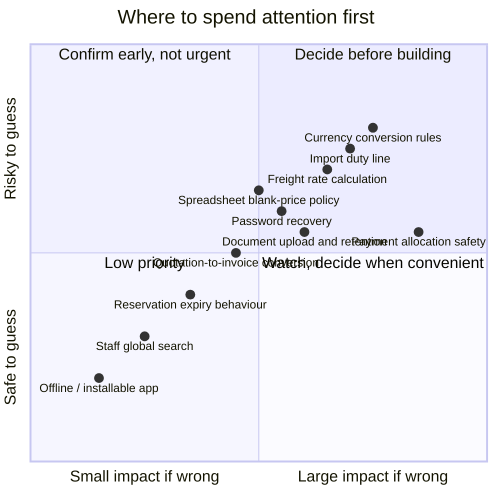
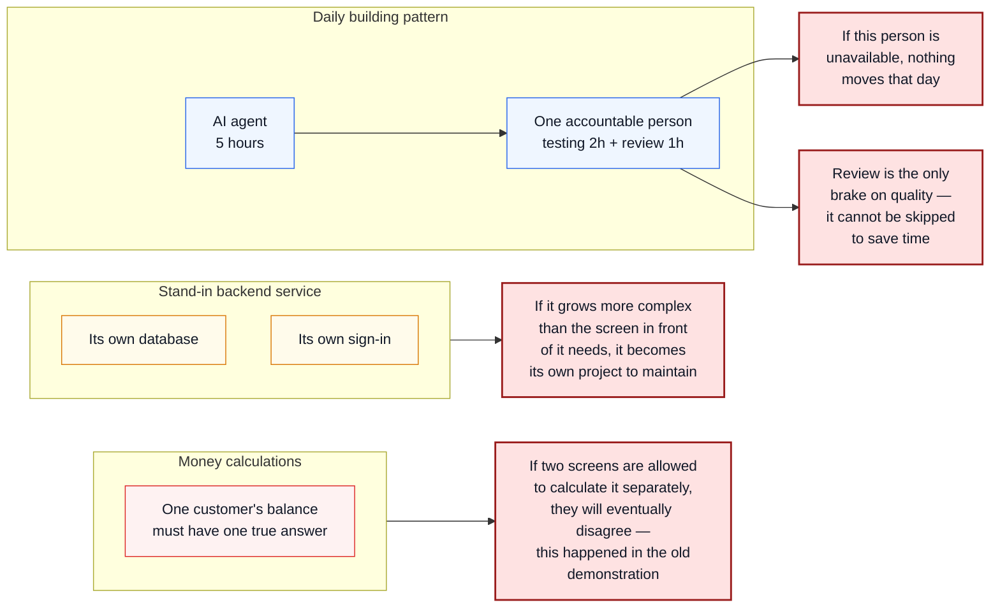
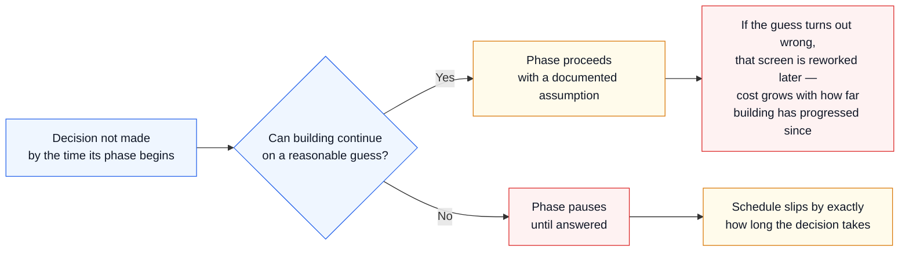

# CarChief Frontend Rebuild — Implementation Risks

**Document purpose:** A plain-language register of everything uncertain, unverified, or waiting on a decision before or during the build — so none of it becomes a surprise mid-delivery.
**Companion documents:** [Implementation Plan](./CarChief-Frontend-Implementation-plan.md) · [Implementation Roadmap](./CarChief-Frontend-Implementation-Roadmap.md)
**Source of these risks:** Hands-on operation of the running demonstration system, screen by screen, plus the practical realities of building each delivery with an AI agent.

---

## 1. What this document is

Before building anything, the existing demonstration system was run in a real browser and every screen was used by hand — clicked, filled in, submitted, edited, deleted, and checked against what it actually stored.

Most of it worked, and worked well. But some things could not be confirmed no matter how the demonstration was used, because the data needed to test them simply does not exist in the demonstration, or because the feature is not actually connected to anything. Separately, building this project in a new way — with an AI agent doing the construction, one person reviewing it daily, and a stand-in backend service running alongside — introduces its own set of risks that have nothing to do with the old demonstration at all.

This document collects both kinds of risk in one place, ranks them, and states plainly what happens if each one is left unanswered.

**Nothing in this document should be read as "the plan is unsafe."** Every item here was already known before the affected phase starts, which is the entire point of testing the demonstration first. A risk written down and assigned an owner is a managed risk.

---

## 2. How to read this document

| Term | Meaning |
|---|---|
| **Cannot verify** | We tried to test this in the demonstration and could not — the data, the connection, or the feature was missing |
| **Business decision needed** | The demonstration shows a behaviour, but CarChief has not yet confirmed whether that is the correct behaviour for the real business |
| **Delivery risk** | A risk that comes from how this project is being built, not from the old demonstration |
| **Blocks** | The delivery phase that cannot be finished properly without an answer |
| **Severity** | How much damage a wrong guess would do if we built ahead of an answer |
| **Likelihood** | How likely it is that our best guess, if we had to make one today, would turn out wrong |

---

## 3. Risk map — what is unresolved before each delivery

```mermaid
flowchart TB
    subgraph D1["Delivery 1 — Public Website"]
        direction TB
        R1a["Freight rate rules unknown"]
        R1b["City delivery rate rules unknown"]
    end

    subgraph D2["Delivery 2 — Customer Application"]
        direction TB
        R2a["No password recovery in demo"]
        R2b["No documents ever uploaded"]
        R2c["Email / print never triggered"]
    end

    subgraph D3["Delivery 3 — Salesperson Application"]
        direction TB
        R3a["Currency conversion never ran"]
        R3b["Import duty not modelled"]
        R3c["Spreadsheet import untested"]
        R3d["Image management unreachable"]
        R3e["Quotation-to-invoice unreachable"]
        R3f["Registers unreachable"]
        R3g["Payment allocation unproven"]
        R3h["Reservation expiry never observed"]
        R3i["Staff search unreachable"]
    end

    subgraph D4["Delivery 4 — SEO & Release"]
        direction TB
        R4a["Offline / installable app — not an approved requirement"]
    end

    D1 -.->|"answer before phase 1.5"| Gate1{{"Business decision"}}
    D2 -.->|"answer before phase 2.1 / 2.7"| Gate2{{"Business decision"}}
    D3 -.->|"answer before phase 3.5 / 3.7"| Gate3{{"Business decision"}}
    D4 -.->|"answer before phase 4.4"| Gate4{{"Business decision"}}

    classDef d1 fill:#fff7ed,stroke:#d97706,color:#111827
    classDef d2 fill:#ecfdf5,stroke:#059669,color:#111827
    classDef d3 fill:#fef2f2,stroke:#dc2626,color:#111827
    classDef d4 fill:#eff6ff,stroke:#2563eb,color:#111827
    classDef gate fill:#fefce8,stroke:#ca8a04,color:#111827,stroke-width:2px
    class R1a,R1b d1
    class R2a,R2b,R2c d2
    class R3a,R3b,R3c,R3d,R3e,R3f,R3g,R3h,R3i d3
    class R4a d4
    class Gate1,Gate2,Gate3,Gate4 gate
```

**Plain-language explanation:** Delivery 3 — the Salesperson Application — carries by far the largest concentration of open questions. This is expected: it is the largest and most complex of the three applications, covering sales, finance and administration in one place. It also means Delivery 3 is where slipping past an unanswered question would cause the most rework, so its decisions should be chased earliest.

---

## 4. Priority view — impact against how likely we are to guess wrong

**Plain-language explanation:** Items in the top-right — currency rules, the import duty line, and freight calculation — are both hard to reverse and easy to get wrong without an answer today. Those three should be decided before Delivery 3's pricing work (phase 3.5) begins. Items in the bottom-left, like whether the app should work offline, can safely wait.

---

## 5. Things we could not verify by testing the demonstration

Eighteen items exist in the demonstration but could not be confirmed by using it — either the data needed to reach them does not exist, or the feature is not actually connected to anything. Each needs a business answer before its phase starts, not during it.

| # | What we could not confirm | Why we could not confirm it | What could go wrong if we guess | Blocks | Severity |
|---|---|---|---|---|---|
| UV-1 | Currency conversion working end to end | The only payment example in the demonstration is in the same currency it was billed in — no conversion ever happens | Rounding, timing and rate-source rules get built on assumption; a real multi-currency payment could be calculated wrong | Phases 3.5, 3.7 | High |
| UV-2 | Exchange rate history | No history records exist in the demonstration | We would design a history screen with no real example of what it should contain | Phase 3.7 | Low |
| UV-3 | Freight rate calculation | No freight rates are loaded, and the demonstration's own "load starting rates" button does not work | Freight charges on a real quotation could be wrong or missing entirely | Phases 1.5, 3.8 | High |
| UV-4 | City/inland delivery rate calculation | No delivery rates are loaded | Delivery cost estimates shown to a customer could be wrong | Phases 1.5, 3.8 | Medium |
| UV-5 | Import duty | The demonstration has a general "tax percentage" field but nothing specifically for import duty | A real quotation could under-charge a customer on landed cost | Phase 3.5 | High |
| UV-6 | What happens during a spreadsheet import | No file could be uploaded to see the outcome | Bad or duplicate data could be accepted with no warning | Phase 3.3 | Medium |
| UV-7 | Managing vehicle photos | The screen exists but could not be reached with the data available | Photo management could be simpler or more complex than assumed | Phase 3.2 | Low |
| UV-8 | Turning a quotation into a final invoice | No quotation in the demonstration ever reached that stage | The conversion rules — what carries over, what changes — are unconfirmed | Phase 3.6 | Medium |
| UV-9 | The invoiced and sold vehicle lists | Could not be reached with the data available | Unknown whether these are simple lists or carry extra business logic | Phase 3.6 | Low |
| UV-10 | Splitting commission or credit between salespeople | No example records exist | Commission-sharing rules are currently a guess | Phase 3.7 | Medium |
| UV-11 | Marking a payment as allocated to a vehicle | The button exists but no completed example was found | The exact allocation rule — and how it prevents double-spending the same payment — needs confirming | Phase 3.7 | High |
| UV-12 | What happens when a reservation's time limit runs out | The 48-hour hold never expired during testing | Whether the vehicle returns to stock automatically or needs a person to release it is unconfirmed | Phase 3.5 | Medium |
| UV-13 | Forgotten-password recovery and two-step sign-in | Not present in the demonstration at all | Customers with a forgotten password may have no way back into their account | Phase 2.1 | Medium |
| UV-14 | Uploading a document to a customer's file vault | No documents exist and none could be added | File size limits, allowed file types and who can see what are unconfirmed | Phase 2.7 | Medium |
| UV-15 | Emailing a customer or printing a document | The buttons exist but were never actually triggered | Whether these should connect to a real email service or a real printer driver at launch is unconfirmed | Phases 2.5, 3.5 | Low |
| UV-16 | Searching across customers, vehicles and invoices at once from the staff dashboard | Could not be exercised with the data available | Unknown how broad or how fast this search needs to be | Phase 3.1 | Low |
| UV-17 | Recording several payments at once, and previewing uploaded proof of payment | No example records exist | The bulk-entry screen's exact behaviour is a guess until confirmed | Phase 3.7 | Medium |
| UV-18 | Making the site work offline / installable like an app | Present in the underlying files but never confirmed as something the business actually wants | Effort could be spent on a feature nobody asked for, or a wanted feature could be silently dropped | Phase 4.4 | Low |

---

## 6. Risks in how this project is being built

These have nothing to do with the old demonstration. They come from the decisions made about *how* to build this project: one person, one AI agent, a stand-in backend service, and a design that must survive a real backend arriving later.

| Risk | Why it matters | What could go wrong | How the plan already guards against it | Decision or action needed |
|---|---|---|---|---|
| **One person carries the daily workload** | The whole schedule assumes one accountable person building, testing and reviewing every working day | If that person is unavailable for any stretch, the schedule pauses — there is no second reviewer to hand work to | The daily pattern (5h build / 2h test / 1h review) is fixed and visible, so a pause is easy to see and communicate | Agree a plan for planned and unplanned absence before Delivery 1 starts |
| **A customer's balance must have one true answer** | The old demonstration showed a customer's outstanding balance as five different figures on five different screens, all disagreeing | If the new build lets each screen calculate this separately again, the same confusion returns — and it directly affects money owed | Every screen that shows a balance is required to read it from a single place, and this will be checked before Delivery 2 is accepted | Confirm which record is the authoritative one for "what a customer owes" before Delivery 2 begins |
| **The stand-in backend service could grow too complex** | It is being built by an AI agent and is meant to stay small and cheap to extend, one screen at a time | If it grows ahead of what screens actually need, it becomes an expensive side-project that competes with the real applications for time | The service is scoped to grow only as each screen requires it, and its design is deliberately kept simple | None — this is a discipline to maintain through the whole build, not a single decision |
| **Automatic price estimation on spreadsheet import** | The old demonstration states it can guess a vehicle's price automatically when a spreadsheet leaves it blank | If carried forward without a decision, the system could silently invent a sale price nobody approved | Flagged in the plan as needing an explicit answer, not assumed | Decide: reject blank prices, or allow automatic estimation, before Phase 3.3 |
| **Copying a broken behaviour by mistake** | Several things in the old demonstration looked like real features but were not — for example, its "AI search" made no real search happen at all, it just matched simple keywords | If that distinction is missed, the new build could either promise something it does not deliver, or under-deliver something the business actually wanted | The plan lists which POC behaviours are proven correct and which are not, so they are not confused | None — already accounted for in the plan; flagged here so it stays visible |
| **Moving from the stand-in sign-in to AutoPulse's real sign-in** | The applications are being built against a temporary sign-in system that stands in for AutoPulse's real one | If the two systems describe a user's role or permissions differently, some screens could behave differently the day AutoPulse is connected | The applications are designed to only ever look at "who is this person and what can they do" — never at how that answer was produced | Confirm AutoPulse's exact role and permission structure before that switch-over, even though it is outside this project's scope |
| **Keeping the visual theme disciplined** | The look of the old demonstration is being kept, but built so it can be swapped later without reworking every screen | If screens are built with one-off colours and spacing instead of the shared theme, that flexibility is lost quietly, one shortcut at a time | A rule is included from day one that no screen may use a colour or spacing value that is not part of the shared theme | None — a discipline to maintain, checked automatically as part of review |
| **Legacy website addresses** | The old public website may have addresses that search engines and old links still point to | If a full list of these old addresses is not supplied, some visitors following old links or search results could land on a broken page | Delivery 4 includes redirect handling, but it can only redirect addresses it has been told about | Supply the list of legacy addresses before Delivery 4 begins |

---

## 7. What happens if a decision is delayed

**Plain-language explanation:** Every open item in this document is cheaper to resolve today than after its phase has been built. Some can be worked around with a documented, reversible assumption; the money-related ones — currency rules, import duty, payment allocation — should not be guessed at all, because a wrong assumption there means rebuilding calculations that other screens will already depend on.

---

## 8. Ranked summary

The single highest-priority group is the money-related decisions, because they are both hard to change once built and directly affect what a real customer is charged or owed.

| Priority | Item | Type | Decide before |
|---|---|---|---|
| 1 | Currency conversion rules (rounding, timing, rate source) | Cannot verify | Phase 3.5 |
| 2 | Import duty as its own line | Cannot verify | Phase 3.5 |
| 3 | Payment allocation safety rule | Cannot verify | Phase 3.7 |
| 4 | Which record is the true source of a customer's balance | Delivery risk | Phase 2.2 (before Delivery 2 acceptance) |
| 5 | Freight rate calculation rules | Cannot verify | Phase 1.5 |
| 6 | Spreadsheet blank-price policy | Delivery risk | Phase 3.3 |
| 7 | City/inland delivery rate calculation rules | Cannot verify | Phase 1.5 |
| 8 | Password recovery and two-step sign-in requirement | Cannot verify | Phase 2.1 |
| 9 | Document upload rules — size, type, access, retention | Cannot verify | Phase 2.7 |
| 10 | Quotation-to-invoice conversion rules | Cannot verify | Phase 3.6 |
| 11 | Commission / allocation splitting between salespeople | Cannot verify | Phase 3.7 |
| 12 | Reservation expiry behaviour | Cannot verify | Phase 3.5 |
| 13 | Legacy public website address list | Delivery risk | Phase 4.1 |
| 14 | Bulk payment entry and proof preview behaviour | Cannot verify | Phase 3.7 |
| 15 | AutoPulse's real role and permission structure | Delivery risk | Before AutoPulse switch-over (outside this project) |
| 16 | One-person absence plan | Delivery risk | Before Delivery 1 starts |
| 17 | Email and print delivery — connect to a real service or not | Cannot verify | Phases 2.5, 3.5 |
| 18 | Vehicle photo management detail | Cannot verify | Phase 3.2 |
| 19 | Staff global search scope | Cannot verify | Phase 3.1 |
| 20 | Offline / installable app requirement | Cannot verify | Phase 4.4 |

---

## 9. Conclusion

Nothing in this register is a defect in the plan — it is the plan being explicit about what it does not yet know. Eighteen of the twenty items above come directly from operating the old demonstration by hand rather than guessing from files; the remaining items come from thinking honestly about how a single-person, AI-assisted build actually behaves day to day.

The four highest-priority items — currency rules, import duty, payment allocation, and the single source of truth for a customer's balance — should be answered before Delivery 3's pricing work begins. Everything else can be answered on the ordinary rhythm of the project, phase by phase, without slowing anything down today.
